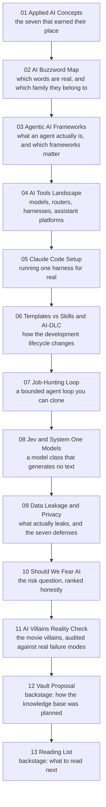

# Applied AI: How the Pieces Fit

> **Created:** 2026-10-19
> **What this is:** the front door of the personal AI series. It started with one question ("which AI / LLM concepts are actually worth knowing, heading into Q4 2026?") and grew into vocabulary, agent internals, the tool layers, how the work changes, one worked agent loop, a model class that is not an LLM, what leaks, and how scared to be. Thirteen notes, one web.
> **Reading order:** 01 to 13, top to bottom. The wikilinks connect everything, so any entry point works.
> **There is no conclusion note, on purpose.** The field has not concluded, so a conclusion would be a lie with a date on it. Every note is `status: living`, new notes append as 14, 15, ... when a real question appears, and note 13 is a forward edge, not an ending.

## The chain

## The notes

| # | Note | The question it answers |
|---|---|---|
| 01 | [[01_applied-ai-concepts-q4-2026]] | Which AI concepts are actually worth knowing right now, ranked by maturity? |
| 02 | [[02_ai-buzzword-map-2026]] | Which of these AI words are real, and how do I judge a new one on sight? |
| 03 | [[03_agentic-ai-frameworks-and-terminology]] | What is an agent, really, and which frameworks and protocols are worth learning? |
| 04 | [[04_ai-tools-landscape-2026]] | Where do routers, harnesses, and assistant platforms sit relative to each other? |
| 05 | [[05_claude-code-setup]] | How do I actually run one of these harnesses day to day? |
| 06 | [[06_templates-vs-skills-and-ai-dlc]] | How does AI change the development lifecycle, and what does AI-DLC even mean? |
| 07 | [[07_job-hunting-as-loop-engineering]] | How do I build a bounded agent loop with verified progress and designed exits? |
| 08 | [[08_jev-system-one-models]] | What if the model is not an LLM at all, and returns typed decisions instead of text? |
| 09 | [[09_ai-data-leakage-and-privacy-2026]] | Does AI really leak my data and keys, and if so, how do I stop it? |
| 10 | [[10_should-we-fear-ai-2026]] | How scared should I be, and of exactly what? |
| 11 | [[11_ai-villains-reality-check]] | Could GLaDOS or Ultron actually happen, and what do the villains map onto? |
| 12 | [[12_ai-engineering-knowledge-vault-proposal]] | Backstage: how was the AI knowledge vault planned and layered? |
| 13 | [[13_ai-engineering-reading-list]] | Backstage: what should I read to go deeper? |

## Why this order

The order walks one question outward, then back in:

1. **Know what matters (01).** Start with the seven concepts that have crystallized into consensus. Everything after this is elaboration.
2. **Learn the names (02, 03).** Jargon arrives in families, so learn the families before the individual words. Then go inside the one family that dominates: agents.
3. **Place the tools (04, 05).** Turn vocabulary into a layer map (model, router, harness, platform), then run one harness for real. Reading about a harness without touching one teaches nothing.
4. **Change how you work (06, 07).** Zoom out to the lifecycle, then build your own bounded loop as the worked example.
5. **Get surprised (08).** A model class that gives up text generation entirely is the strongest counterexample to everything in 01 to 07. Read it once you have a stack in your head to compare it against.
6. **Make it safe (09, 10, 11).** Leakage mechanisms first, because they are concrete and fixable. Then the fear question, calm. Then the fiction audit, which is the same audit with better costumes.
7. **Go deeper (12, 13).** Backstage notes: how the vault was planned, and what to read next.

## How this series works

- Every note keeps the house shape: **Your question** at the top, a short answer, numbered sections, a TL;DR or verdict table, honest status labels, a Skeptic's corner where the claim earns it, Related notes, and Sources with a verification date.
- All notes carry the tag **#ai-series**: search the tag to find them from anywhere in the vault.
- Files are numbered in reading order. New notes append as 14, 15, ... when a real question appears, not on a schedule.
- `status: living` means the note is expected to age. **Re-verify tooling, models, prices, and vendor policies before citing any of them in an ADR.** The stable part is the judgment; the volatile part is the facts.
- Notes 12 and 13 are **backstage**. They document the making of the knowledge base, not the knowledge. Read them when you want to know where the deeper material lives.

## Where the deep layer lives

This folder is the public-facing layer: opinions, maps, and calibrated judgments. The textbook-grade fundamental and applied material lives in the separate vault:

- `F:\obsidian_note\ai-knowledge\` - foundations, core ML, foundation models, applied AI engineering, operations, governance. That vault was built from [[12_ai-engineering-knowledge-vault-proposal]] and stocked from [[13_ai-engineering-reading-list]].
- `F:\obsidian_note\swe-knowledge\career-path\18_Applied_AI_Engineer\` - the six capability areas that frame the whole discipline.

Cross-vault references in these notes are written as inline code paths, not wikilinks, because links do not resolve across vaults.

## Candidate notes (a menu, not a plan)

- **RAG, properly:** retrieval quality, chunking, reranking, and why naive RAG plateaus. Referenced from 01 but never given its own note.
- **Evaluation:** an eval suite with a baseline and a CI regression gate. The notes keep saying "evals are the real deliverable" without showing one built end to end.
- **Cost and latency engineering:** routing and cascading appear in 01 and 04 as vocabulary. Nothing here measures a token bill or a p95.
- **Guardrails architecture:** 09 goes deep on leakage; input and output filtering, and least-privilege tool scoping, are still only referenced.
- **Fine-tuning strategy:** when it is worth it (rarely), and how to prove it beat prompting.
- **Multi-agent orchestration:** 03 covers the primitives (handoff, supervisor). No worked multi-agent system yet.
- **Model card and AI risk assessment:** the governance artifacts. Nothing in this folder produces one.
- **The next model-class surprise:** 08 exists because a new model class appeared. Assume another will, and keep the slot open.

## Knowledge connections

- [[01_applied-ai-concepts-q4-2026]]: the origin question, and the map every later note hangs off.
- [[02_ai-buzzword-map-2026]]: the vocabulary hygiene layer. Read this before believing any vendor deck.
- [[03_agentic-ai-frameworks-and-terminology]]: the agent internals; the deepest technical note in the series.
- [[04_ai-tools-landscape-2026]]: the layer map that makes every new AI tool instantly placeable.
- [[05_claude-code-setup]]: the only note here that ends in a working terminal.
- [[06_templates-vs-skills-and-ai-dlc]]: the bridge from "I use an AI tool" to "my team's process changed".
- [[07_job-hunting-as-loop-engineering]]: the worked instance of loop engineering, with a human gate that never leaves.
- [[08_jev-system-one-models]]: the counterexample note. Confidence-gated decisions instead of generated strings.
- [[09_ai-data-leakage-and-privacy-2026]]: the concrete half of risk, with receipts and a self-audit.
- [[10_should-we-fear-ai-2026]]: the opinion note the whole risk cluster hangs from.
- [[11_ai-villains-reality-check]]: the same audit, wearing costumes. Fun, and it teaches the failure taxonomy better than a slide deck.
- [[12_ai-engineering-knowledge-vault-proposal]] and [[13_ai-engineering-reading-list]]: backstage. Structure and sourcing for the deep vault.

## Key takeaways

- The series is one question followed honestly: know, name, build, use, reorganize, loop, surprise, secure, calibrate, debunk.
- Reading order is a suggestion; the links are the actual map.
- No conclusion note exists because the field has not concluded. New notes join when a real question appears, not to fill a syllabus.
- The judgment in these notes is meant to outlive the facts. Re-verify the tools, keep the reasoning.
