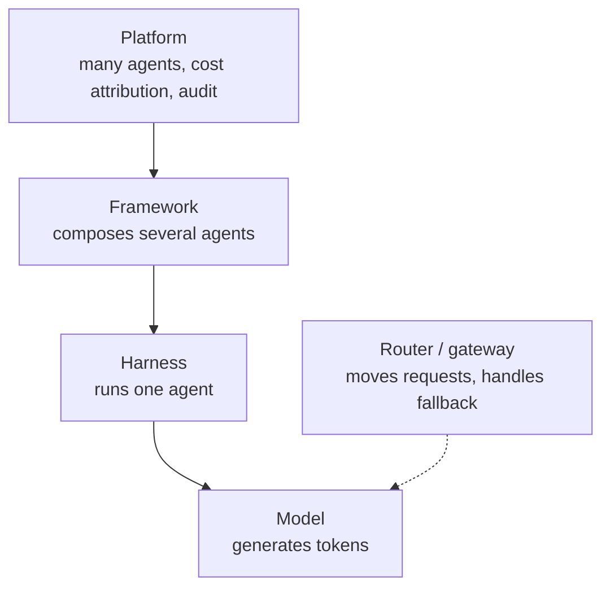
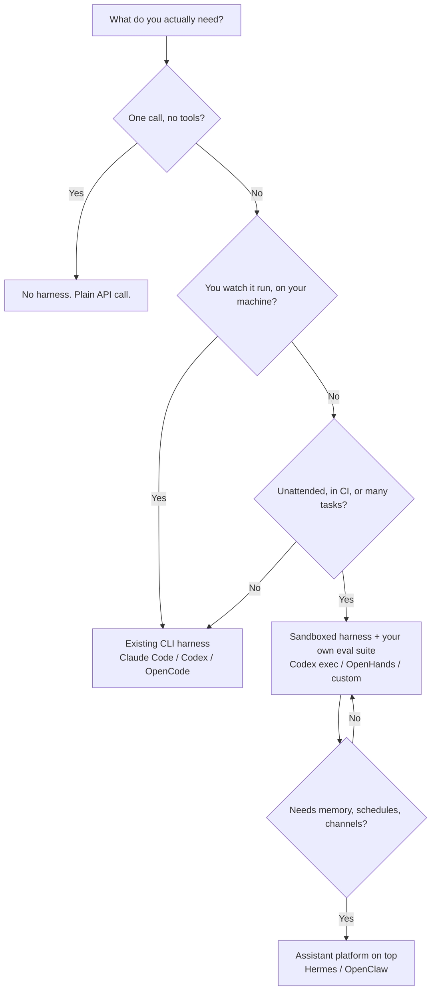

# Agent Harness Anatomy (Q4 2026): Minimum, Good, Best, and Who Ships What

> **Your question:** What are the components of a good agentic harness - tool calling, memory, and the rest? What is the *minimum* set, what is *good* to have, what is *best* to have, and how do the harnesses on the market compare?
> **Short answer:** Agent = model + harness, and the harness is everything that is not the model. Seven components are irreducible: a **loop with stop conditions**, a **tool set**, a **shell escape hatch**, **context assembly with compaction**, a **permission boundary**, a **project context file**, and a **trajectory log**. Everything past that is an answer to a failure you have actually seen. The market differs less in *which* components exist than in **how well each one is built** - and the measured difference is worth 10 to 20 points of task success on the *same model*.
> **Verification:** All facts web-checked 2026-10-19. Licences, star counts, and feature sets churn monthly - re-verify before citing in an ADR.
> **Companion:** The layer map (model / router / harness / platform) is in [[04_ai-tools-landscape-2026]]. Agent internals and the "-X engineering" vocabulary are in [[03_agentic-ai-frameworks-and-terminology]]. One harness run for real: [[05_claude-code-setup]]. The practice of maxing a harness out is in [[15_harness-maxxing-2026]].

---

## 1. Definition, and the three-question boundary test

**A harness is every piece of code, configuration, and execution logic that is not the model.** A raw model cannot hold durable state, execute code, reach live data, or set up an environment. The harness is what gives it those things, plus the constraints that keep them safe.

That definition is almost too broad, so use three tests to place any tool:

1. Does it generate tokens itself? -> **model**
2. Does it run a loop where the model decides the next action? -> **harness** (or **platform**, if it also has memory, schedules, and channels)
3. Does it only move requests between things? -> **router / gateway**

If the answer is "it gives you abstractions and you assemble the loop", it is a **framework**, not a harness. The distinction matters commercially, not just pedantically:

| | Framework | Harness |
|---|---|---|
| **Purpose** | Build and orchestrate agent logic | Run one agent reliably, out of the box |
| **Examples** | LangGraph, CrewAI, Microsoft Agent Framework, OpenAI Agents SDK | Claude Code, Codex, OpenCode, Hermes Agent |
| **You get** | APIs, state graphs, knobs | A working loop, tools, permissions, traces |
| **Failure mode** | You configured it wrong | It was designed wrong, and you inherit that |
| **When to adopt** | You are building a product that *is* an agent | You want an agent doing work today |

A useful sanity check from the field: **a harness ships as a working agent.** There is no assembly step. If you have to write the loop before it does anything, it is a library.

### The four layers (keep them separate)



Most "which tool is better" arguments are two people comparing different layers. A router will never fix a bad harness. A harness will never fix a model that cannot follow tool schemas. And a framework does not save you from designing a harness badly - it just gives you more rope.

---

## 2. The component inventory (all 19, ranked into tiers)

Every component below exists because a model cannot do that thing by itself. If you cannot name the behaviour a component delivers, it should not be in your harness - and that is the actual design rule here. The last column is **how you actually build it**: the tool, pattern, or method that ships in real harnesses as of Q4 2026.

**M** = minimum viable. **G** = good to have (production). **B** = best to have (frontier).

| # | Component | Job it does | What it looks like when it is missing | Tier | How you build it (tools / method) |
|---|---|---|---|---|---|
| 1 | **Outer loop + stop conditions** | Calls the model, executes tool calls, feeds results back, decides when to stop | Runs forever, or stops after one step and calls it done | M | Hand-roll a `while` loop with explicit counters, or take a runtime: OpenAI Agents SDK `Runner`, LangGraph (with a checkpointer), or the harness's own loop. Four guards: `max_steps`, token budget, wall-clock timeout, identical-call repeat counter. |
| 2 | **Tool set + schemas + validation** | The action space: read, write, search, run | Hallucinated arguments, wrong tool chosen, silent bad input | M | JSON Schema per tool - Pydantic in Python, Zod in TypeScript. Write descriptions like API docs (when to use, when not to). Wrap reusable integrations in an MCP server. Start under 10 tools; add on a documented failure. |
| 3 | **A general-purpose escape hatch (shell / code)** | Lets the model build the tool it needs on the fly | Needs a human to pre-build every possible action | M | `subprocess`/`exec` with pinned cwd and an env allowlist, or the harness's built-in bash. Pair it with a real file-edit tool (`str_replace`, `apply_patch`): a bash-only agent scored 28% on SWE-bench Pro, and adding one edit tool took it to 50.7%. |
| 4 | **Context assembly + compaction** | Decides what reaches the window; summarizes or offloads the rest | Context rot: performance decays over a long session | M | Count tokens per turn with the model's tokenizer. Clip tool output at ingest (16 KB is a sane shell cap, 250 lines for grep). Summarize old turns into a running state file. Offload big artifacts to disk and keep only the path. |
| 5 | **Permission boundary** | Allow / deny / ask, path scoping, least privilege | One `rm -rf` away from an incident | M | Path allow-list checked before every write. An approval callback for irreversible verbs (delete, push, spend, send). Enforce with Codex approval modes, Claude Code `permissions` + a `PreToolUse` hook, or a policy engine. Never rely on prompt text. |
| 6 | **Project context file** | Standing instructions: conventions, commands, constraints | Repeats the same mistake every session | M | One human-written `AGENTS.md`, under ~100 lines, acting as a table of contents into `docs/` and rule files. Reuse the same file as `CLAUDE.md`/`GEMINI.md` (symlink) so every harness reads one source. Machine-generated versions measurably hurt. |
| 7 | **Trajectory log** | Every step, tool call, result, and cost | You cannot debug it, and you cannot evaluate it | M | Append-only JSONL per run: step, tool, args, result hash, tokens, latency, approval decision. Use OTel GenAI semantic conventions for portability. Backends that ingest it: Langfuse, Arize Phoenix, LangSmith, Braintrust, Logfire. |
| 8 | **Sandbox + default toolchain** | Isolated execution with runtimes, git, test runner preinstalled | Agent runs as you, on your machine; results not reproducible | G | A container per task (Docker, devcontainer) or a sandbox SDK: E2B, Modal Sandboxes, Daytona, Cloudflare Sandbox SDK. Bake the image with language runtimes, git, test runner, and a browser. An empty container is not a workspace. |
| 9 | **Subagents + handoff + recursion limit** | Isolated context per subtask; parallel work | Context explosion, or an agent team that deadlocks | G | A spawn API that returns a summary, not a transcript: Claude Code `.claude/agents/*.md`, OpenAI Agents SDK handoffs, Hermes `delegate_task`. Read-only tools first, depth cap of 2, hard cap on concurrent children. |
| 10 | **Lifecycle hooks / middleware** | Deterministic pre/post actions: lint, format, block, compact, continue | Rules that only exist as prose, so they get skipped | G | Claude Code `settings.json` hooks (`PreToolUse`, `PostToolUse`, `Stop`), git `pre-commit`, a post-edit runner (`ruff`, `prettier`, `tsc`), plugin middleware. The exit code is the control signal - non-zero feeds back to the model. |
| 11 | **Durable session + resume** | Persisted state, crash recovery, pause and continue | Long task dies at step 40 and everything is lost | G | Persist after every step: JSONL plus a workspace diff. LangGraph checkpointer, a durable-execution engine (Temporal), or sqlite plus a `resume` command. Test it by killing the process at step 10. |
| 12 | **Memory and retrieval** | Cross-session facts, plus live knowledge (web, docs, MCP) | Re-learns your setup every session; answers from a stale cutoff | G | Files the agent writes itself (`MEMORY.md`, `decisions/`) plus a retrieve-at-start step. A vector store (pgvector, sqlite-vec) only when the corpus is genuinely large. Ship a prune path or stale entries will poison retrieval. |
| 13 | **Connectivity (MCP or equivalent)** | Standard way to attach tools and data | Every integration is bespoke glue | G | MCP servers (filesystem, postgres, searxng, github), a tool gateway like Composio for SaaS auth, OpenAPI-to-MCP for internal APIs. Load on demand: a large server can cost 1.17M tokens in definitions before the first turn. |
| 14 | **Self-verification loop** | Runs tests, lint, typecheck, or the app, and reads the result | Declares victory on broken code | G | One `verify` command (`make test && make lint`, `bun test`, `pytest -q`) run from a `Stop`/pre-exit hook and injected back. Parse exit codes, not prose. Playwright screenshot when the artifact is a UI. |
| 15 | **Evals for the harness itself** | A task set + baseline, so a harness change is measurable | Tuning by vibes; every change is a coin flip | G | Turn your own traces into cases: 20 to 50 JSONL tasks with a pass check. Run with pytest, promptfoo, or Inspect; store results per commit; gate CI on regression against the baseline. |
| 16 | **Context reset + handoff artifact** | Clears the window and hands state forward in a file | "Context anxiety": the agent wraps up early as the window fills | B | A handoff template (`state.md`: goal, done, next, open questions, files touched). Spawn a fresh session with only that file. Validate the artifact exists before the old context is dropped. |
| 17 | **Generator / evaluator separation** | One agent does the work, a skeptical one grades it | The agent grades its own work and praises it | B | Separate prompt plus a rubric written as gradable criteria, run on a different (cheaper) model, never sharing the generator's context. Return pass/fail per criterion - not a score out of 10. |
| 18 | **Deferred loading / capability composition** | Tools and instructions load when reached for, not upfront | Tool definitions alone eat the window before the first turn | B | A one-line catalog entry per capability plus a `load` tool (Pydantic AI `ToolSearch` / `defer_loading`, or RAG over skill files). Bundle instructions and tools together so they arrive in one step. |
| 19 | **Fleet layer + governance** | Many agents, cost attribution, policy, audit trail | No idea what anything costs or who approved what | B | Gateway for cost attribution (LiteLLM, Portkey, OpenRouter), a per-run budget enforced at the gateway, an audit table (who, what, approved by, cost), and a policy engine (OPA/Cedar) in front of tool calls. |

> **The ordering is not a maturity ladder for its own sake.** Each tier is defined by a failure you can no longer tolerate. A prototype tolerates all of the G and B failures. A production agent tolerates none of the M failures, most of the G failures, and can still ship without B.

---

## 3. Tier 1: the minimum viable harness

The test: **it can run a 10-step task on your repository, stop on its own, and you can read exactly what it did.** If any of these seven is missing, you do not have an agent - you have a prompt with extra steps.

### 3.1 Outer loop with stop conditions

The core architecture is a `while` loop: assemble context, call the model, execute the tools it asked for, append results, repeat, until the model returns no tool calls or a guard trips.

Four guards are non-negotiable, and they are cheap:

- **max steps** - iteration cap, not a suggestion
- **token / cost budget** - spend cap per run
- **wall-clock timeout** - because some loops are slow, not expensive
- **repeated-action detection** - the same tool call three times in a row is a stuck agent, not a determined one

The failure this prevents is the expensive one: an agent that is "making progress" forever. The opposite failure - stopping too early - is usually a prompt and context problem, not a loop problem.

### 3.2 Tool set with schemas and validation

Tools are the agent's hands, and the schema is the contract. Two rules from the evidence:

- **Keep the action space small.** Tool count is a performance setting, not a feature list. Vercel reported stripping 80% of an agent's tools and moving success from 80% to 100% on the same model, with tokens more than halved and latency from 724s to 141s. Treat the magnitude as second-hand (Vercel's own page flags it) but the direction as solid: fewer, sharper tools win.
- **Validate every argument before execution.** The model will emit a path that does not exist, a flag that is not real, or a JSON shape that looks right. Schema validation turns a silent failure into an error message the model can act on.

### 3.3 A general-purpose escape hatch

Every serious harness ships a shell or code-execution tool. Not because bash is elegant, but because you cannot pre-design a tool for every problem, and models are trained on billions of tokens of shell usage. Handing over bash plus a filesystem is the difference between giving someone a kitchen gadget and giving them a kitchen.

The practical consequence: **the built-in tool list should be small and stable, and the model should compose the rest through the shell.** That is also why "we have 60 tools" is usually a warning sign, not a selling point.

### 3.4 Context assembly and compaction

The window is a budget, and most harnesses spend it badly. Three mechanisms belong in the minimum:

1. **Truncation on ingest** - cap the size of any single tool result (file read, grep output, command output). A 10 MB file read is not context, it is a denial of service.
2. **Compaction** - when the window approaches its limit, summarize older turns and keep the recent ones verbatim.
3. **Offloading** - write large intermediate artifacts to disk and keep a pointer in context.

Compaction is where a harness starts to feel intelligent. It is also where it silently loses the one detail that mattered, so it needs to be visible in the trajectory.

### 3.5 Permission boundary

The minimum version is not a sandbox. It is a decision function with three outcomes: **allow**, **deny**, **ask**. Two hard-won lessons:

- **A rule that ends in a prompt is not a rule.** Anthropic reports that 93% of permission prompts get approved. A 113-participant study found that people who wrote permission rules in advance blocked 20.1 percentage points *fewer* bad actions than people who approved each action as it came - because they set most rules to "ask" and then approved anyway.
- **Enforce the irreversible things mechanically.** Deleting outside the workspace, pushing to a protected branch, spending money, sending external messages. If it cannot be undone, it should not be a suggestion in a prompt.

### 3.6 Project context file

`AGENTS.md`, `CLAUDE.md`, `QWEN.md`, `.goosehints` - the name changes, the mechanism does not: a file at the repo root that gets injected into the system prompt on every run.

The evidence here should make you *smaller*, not bigger:

- ETH Zurich tested context files across 138 real-world tasks: **machine-generated context files reduced task success compared to giving the agent no context at all**, while increasing inference cost by over 20%. Human-written files helped by about 4%.
- Either way the agent spends 14 to 22% more reasoning tokens to get there.
- OpenAI tried the single giant instruction file and named four ways it failed: it crowds out the actual task, "when everything is important, nothing is", it rots into a graveyard of stale rules, and it cannot be checked mechanically. They replaced it with roughly 100 lines and a table of contents.

So: short, human-written, every line traceable to a real failure. **A rule you cannot trace to an incident is a rule you should delete.**

### 3.7 Trajectory log

Every step, every tool call, every result, every token count, every approval decision. This is the substrate for both debugging and evaluation - you cannot build tier 2 (`evals`) on top of a harness that did not record anything.

The cheapest useful format is append-only JSONL plus the raw session transcript. Every harness on the market does some version of this; the difference is whether you can *get it out*.

---

## 4. Tier 2: good to have (production)

The test: **it can run 50+ steps unattended, survive a restart, be traced step by step, and you can prove that a harness change helped.**

### 4.1 Sandbox with good defaults

Running agent-generated code locally is a bet you win until you lose. A sandbox gives you isolation, reproducibility, and scale: create per task, fan out, tear down.

A good sandbox is judged by its **default toolchain**, not just its isolation. Preinstalled runtimes, git, test runners, package managers, a browser for verification. An empty container is not a workspace.

### 4.2 Subagents, with a hard limit

A subagent is a fresh context window plus a scoped tool set. It is the only real answer to "the task does not fit in one window", and it is the most over-used pattern in the field.

The evidence should shape your design:

- Anthropic's long-running harness uses planner, generator, and evaluator agents, and reports that separating the doer from the judge is a strong lever - even though the judge is still an LLM and still generous.
- A four-role team scored 72.2% on SWE-bench 500 against 71.8% for the best single agent. That is a rounding error for four times the complexity.
- Microsoft's Azure operations agent grew past 50 specialists and found that **problems requiring more than four handoffs almost always failed**. They rolled back to a few generalists.
- One ablation study found that **adding a reviewer agent lowered success by 8%** against a 41% baseline.

Subagents are worth it when the work is genuinely separable, the context is genuinely too large, or you need read-only isolation for safety. Not because a diagram looks better with more boxes.

### 4.3 Lifecycle hooks

Hooks are where the harness becomes deterministic. Instead of asking the model to remember to run the linter, the harness runs the linter after every edit and injects the output. Instead of hoping it does not `git push`, a hook blocks it.

Useful hook points: before tool call (rewrite or block), after tool call (validate result), after edit (lint, typecheck, format), on context threshold (compact or reset), on stop (run tests before accepting "done").

This is also the correct home for the "every mistake becomes a rule" practice: when an agent ships a commented-out test, the hook greps the diff for `.skip(` - the prose rule is the backup, the hook is the control.

### 4.4 Durable session and resume

Long tasks fail for boring reasons: network, quota, laptop lid, crashed process. Persisting state (messages, tool results, plan, workspace) turns a lost run into a resumable one.

Kill criterion: if a 40-step run dies and you cannot continue it from step 39, the harness is not production-ready.

### 4.5 Memory, honestly scoped

Memory is the most over-sold component. Split it:

- **Project memory** - the context file plus files the agent writes for itself. This is the durable memory that reliably works.
- **Cross-session memory** - facts about you, your preferences, past decisions. Useful, and the place where stale entries poison retrieval.
- **Live knowledge** - web search, docs, MCP servers. Not memory at all, but it solves the same complaint ("the model does not know X").

The failure mode is not forgetting. It is remembering something wrong and confidently reusing it. Any memory system needs a **prune path**, not just a write path.

### 4.6 Connectivity

MCP won the tool-connection layer. If your integrations are bespoke, you are paying a tax that everyone else stopped paying.

But connectivity has a context cost. Cloudflare found an MCP server with thousands of endpoints would burn 1.17 million tokens on tool definitions before the user said a word. Anthropic reported one workload drop from 150,000 tokens to 2,000 by loading tools on demand. Connect broadly, **disclose narrowly**.

### 4.7 Self-verification loop

The single highest-leverage feature in a coding harness: after changing something, the agent runs the check and reads the result. Tests, typecheck, lint, build, screenshot, HTTP call.

This is what turns "the model wrote code" into "the model delivered working code". It is also the cheapest form of evaluation you will ever get, because the verifier already exists and is deterministic.

### 4.8 Evals for the harness itself

The uncomfortable truth: most teams change their harness (a rule, a tool, a compaction threshold) and never measure whether it helped. That is exactly the mistake evaluation exists to prevent.

A minimum viable harness eval: 20 to 50 real tasks from your own history, a pass/fail or rubric score, a baseline run, and a re-run on every harness change. It does not need to be statistically pure. It needs to exist.

Note what your options are, because the field is thin here: the only ablation study found, NLAH, removed harness components one at a time and measured the delta. That is the method you should copy, at whatever scale you can afford.

---

## 5. Tier 3: best to have (frontier)

The test: **it can run for hours, across sessions, with more than one agent, and be governed.**

### 5.1 Context reset with a handoff artifact

Anthropic's finding is the important one: some models exhibit **"context anxiety"** - they start wrapping up early as they approach what they believe is their context limit. Compaction keeps continuity but does not give a clean slate, so the anxiety persists. A full **reset** does, at the cost of needing a structured handoff that carries state and next steps.

So the frontier pattern is not "compact better". It is **reset, with a written artifact that survives the reset**. The artifact is the memory; the context window is disposable.

### 5.2 Generator and evaluator, separated

Agents reliably praise their own work. Tuning a standalone evaluator to be skeptical is tractable; making a generator critical of itself is not. Anthropic's frontend harness made subjective quality gradable by writing four criteria (design quality, originality, craft, functionality) and giving them to both sides.

Prerequisite: the criteria must be **concrete enough to be graded**. "Is this good?" is not an evaluator prompt. "Does it follow these four principles?" is.

### 5.3 Deferred loading and capability composition

At scale, the harness itself becomes the context problem. The fix is progressive disclosure: show a one-line catalog, load the full bundle when the model reaches for it.

Pydantic's framing is the clearest version: a **capability** bundles instructions, tools, hooks, and model settings into one unit that can defer its own loading, trim results before they overflow, or inject a reminder without poisoning durable history. The model meets the instruction at the moment it can act on it.

### 5.4 Self-improving rule corpus (the ratchet)

The discipline that separates harness engineering from configuration: **every failure becomes a rule, a hook, or an eval case - permanently.** Not a retry, not a shrug, not "wait for the next model".

The strongest public example is a repository that commits a bug write-up per failure, each with a `root_cause` field and a `Prevention` paragraph naming the rule that should have caught it. Every line in a good `AGENTS.md` should be traceable to something that went wrong.

The counterweight: rules are not free. They cost context, tokens, latency, and attention. Remove rules when a capable model has made them redundant, and never add a rule "just in case".

### 5.5 Fleet layer and governance

Once several agents run against the same systems, on machines that are not yours, the harness is no longer the hard part. The platform is: durable execution, per-agent cost attribution, policy, audit, and the ability to answer "who approved this, what did it cost, and what did it touch".

This is the layer where AI engineering becomes ordinary systems engineering again - and where most teams discover they have been running production workloads with no operator.

---

## 6. The evidence: the harness is worth more than you think

Every number below is a **same-model comparison** unless stated otherwise. This is the entire justification for treating the harness as an engineering artifact.

| Claim | Number | Source |
|---|---|---|
| Changing only the harness | LangChain coding agent 52.8% -> 66.5% on Terminal Bench | reported via MongoDB / Winder |
| Same model, different scaffold | Princeton CORE-Bench: 42% under one scaffold, 78% under another | reported via MongoDB / Winder |
| Fewer tools, same model | 80% -> 100% success, tokens more than halved, 724s -> 141s | Vercel (second-hand figure, direction solid) |
| Eight harnesses, one model, 25 tasks | 68% -> 88% success rate | Composio bench, cited by Marmelab |
| Harness work alone, legal domain | more than doubled accuracy | Harvey, reported via MongoDB |
| Machine-written context files | worse than **no** context, +20% inference cost | ETH Zurich, 138 tasks, arXiv 2602.11988 |
| Adding a reviewer agent | -8% success against a 41% baseline | NLAH ablation, arXiv 2603.25723 |
| Four-role agent team vs best single agent | 72.2% vs 71.8% on SWE-bench 500 | arXiv 2602.01465 |
| Handoff depth | beyond 4 handoffs, tasks "almost always failed" | Microsoft Azure SRE agent |
| Approval fatigue | 93% of permission prompts approved | Anthropic, Claude Code sandboxing |

**How to read this honestly:** most of these are vendor or blog-reported, several are single runs, and "harness" is defined differently in each. Do not quote them as a benchmark. Quote them as the reason to *measure your own* - which is the only number that will ever describe your workload.

The one thing the field agrees on: **Terminal-Bench style leaderboards are (model, harness) pairs, not model scores.** A leaderboard row tells you what one harness got out of one model, on tasks that are not yours. That is a shopping signal, not an engineering result.

---

## 7. Five rules that contradict the obvious instinct

1. **Fewer tools beat more tools.** The instinct is to give the agent everything. The evidence says tool count is a performance setting. Start with a handful, add only on a documented failure.
2. **Shorter instructions beat longer ones.** The instinct is a 500-line `AGENTS.md`. The evidence says machine-generated context files actively hurt. An index plus small, checkable rules wins.
3. **Hooks beat rules.** If something must always happen, encode it in the harness, not in a sentence the model might skip. And if a rule ends in a permission prompt, it is not a rule.
4. **A second agent is not automatically better.** A reviewer agent measured -8%. A four-role team beat the best single agent by 0.4 points. Justify every agent you add.
5. **Build the harness from failures, not from a template.** You cannot download the right harness. You can only ratchet toward it.

---

## 8. Market comparison (positioning)

Not an exhaustive list - Marmelab audited 246 repositories that describe themselves as harnesses or contain one, and several names ("OpenHarness") belong to four unrelated projects. This is the set that actually comes up in decisions, checked August to October 2026.

| Harness | Maker / licence | Model freedom | Surface | Genuinely good at | Main weakness | Label |
|---|---|---|---|---|---|---|
| **Claude Code** | Anthropic, proprietary | Anthropic models only | Terminal, IDE, desktop, web | The reference harness: hooks, subagents, skills, permissions, polish | One vendor's models; thin on durable memory by design | ✅ Standard |
| **Codex** | OpenAI, Apache-2.0 | OpenAI models | CLI + cloud | Best-in-class OS sandbox defaults and approval modes; Rust core | One vendor's models | ✅ Standard |
| **OpenCode** | Anomaly, MIT | 75+ providers incl. local | Terminal, TUI | The BYOK / open-weight default; provider-agnostic; fast-moving | Convenience telemetry history; less opinionated safety | ✅ Standard |
| **DeepSeek Harness** | DeepSeek, MIT | Any (plugin-driven) | CLI | Everything is a plugin, including the loop; can drive Claude Code or Codex as subagents | Developer preview since 13 Aug 2026; nothing is stable yet | 🟢 Emerging |
| **Qwen Code** | QwenLM / Alibaba, Apache-2.0 | Qwen-first, broader on paper | Terminal | Best-fitting harness for Qwen models | Fragile with other models; tool-call format gaps | 🟢 Emerging |
| **Goose** | Agentic AI Foundation (Linux Foundation), Apache-2.0 | 15+ providers incl. local | Desktop, CLI, API | Neutral governance, provider-agnostic, MCP-native | Roadmap answers to a foundation, not a deadline | 🟢 Emerging |
| **Zed Agent** | Zed Industries, GPL-3.0-or-later | Drives Claude, Codex, OpenCode via ACP | Editor | Editor-native diff review; orchestrates other harnesses | Assumes you adopted the editor; review UI gaps with external agents | 🟡 Niche |
| **OpenHands** | All-Hands-AI, MIT | Any | Self-hosted web | Sandbox you control; strong for unattended runs | Sandbox protects the filesystem, not the bill; loops on ambiguity | ✅ Standard (self-host) |
| **Pydantic AI Harness** | Pydantic, open source | Any Pydantic AI provider | Python library | Typed capabilities, deferred loading, OpenTelemetry built in | A library, not an app; still 0.x | 🟢 Emerging |
| **Cline** | Cline, open source | BYOK, many providers | VS Code extension | Approval-first UX in the editor; strong for supervised work | Editor-bound; weaker for long unattended runs | ✅ Standard |
| **Aider** | Aider-AI, Apache-2.0 | Many providers | Terminal | Git-native pair programming; excellent repo map | Deliberately short supervised runs; no real subagent story | 🟡 Mature niche |
| **Pi** | earendil-works, open source | Any | CLI | Radical minimalism: four tools, everything else an extension | You build the harness you need | 🟡 Niche |
| **Hermes Agent** | Nous Research, open source | Any provider | Desktop, CLI, messaging | Assistant-platform shape: memory, skills, cron, subagents, channels, profiles | Agent-agnostic breadth means you own more of the tuning | 🟢 Emerging |
| **OpenClaw** | OpenClaw, open source | Any provider | Self-hosted, messaging-first | Persistent personal assistant; channels, plugins, ClawHub skills | Fast-moving, young ecosystem; security surface is your responsibility | 🟢 Emerging |
| **Antigravity** | Google, proprietary | Gemini-first | IDE + CLI + SDK | Full platform: parallel agents, projects, SDK on Google's harness | Vendor gravity; newest of the big-vendor options | 🟢 Emerging |
| **Gemini CLI** | Google, Apache-2.0 | Gemini | Terminal | Generous free tier, simple terminal loop | Least differentiated harness in the set | ✅ Standard |

> **Reading the table:** "model freedom" is the column that decides most adoptions in practice, and it is the one vendors de-emphasise. Claude Code and Codex are the best harnesses for their own models. OpenCode, Goose, and OpenHands are how you use anything else.

### 8.1 Feature matrix (feature presence, not quality)

Presence only. Two harnesses can both have "subagents" and be a year apart in how well it works. `?` means not verified in this pass - do not treat it as absent.

| Harness | Compaction | Subagents | Hooks | OS sandbox | Resume | Skills / plugins | MCP |
|---|---|---|---|---|---|---|---|
| Claude Code | ✅ | ✅ | ✅ | ✅ | ✅ | ✅ | ✅ |
| Codex | ✅ | 🟡 | 🟡 | ✅ | ✅ | 🟡 | ✅ |
| OpenCode | ✅ | ✅ | 🟡 | 🟡 | ✅ | 🟡 | ✅ |
| DeepSeek Harness | ✅ | ✅ | ✅ | ? | ? | ✅ | ✅ |
| Qwen Code | ✅ | 🟡 | 🟡 | 🟡 | ✅ | 🟡 | ✅ |
| Goose | ✅ | 🟡 | 🟡 | 🟡 | ✅ | ✅ | ✅ |
| Zed Agent | 🟡 | 🟡 | no | 🟡 | ✅ | 🟡 | ✅ |
| OpenHands | ✅ | ✅ | 🟡 | ✅ | ✅ | ✅ | ✅ |
| Pydantic AI Harness | ✅ | ✅ | ✅ | ✅ | ? | ✅ | ✅ |
| Cline | ✅ | 🟡 | ✅ | 🟡 | ✅ | 🟡 | ✅ |
| Aider | 🟡 | no | 🟡 | no | 🟡 | no | no |
| Pi | 🟡 | 🟡 | 🟡 | 🟡 | 🟡 | ✅ | 🟡 |
| Hermes Agent | ✅ | ✅ | 🟡 | 🟡 | ✅ | ✅ | ✅ |
| OpenClaw | ✅ | ✅ | ✅ | 🟡 | ✅ | ✅ | ✅ |

Legend: ✅ shipped and documented at time of check, 🟡 partial / plugin-level / new, `no` absent by design, ? not verified.

### 8.2 Which one, by situation

| Your situation | Pick | Why |
|---|---|---|
| You already pay for Claude or ChatGPT | Claude Code / Codex | Best harness for the models you already have |
| Open-weight models, local hardware | OpenCode | Provider breadth is the whole point |
| Unattended runs, CI, untrusted code | Codex `exec` or OpenHands | Sandbox and approval design are the deciding features |
| You are writing a Python service that needs a harness inside it | Pydantic AI Harness | Library shape, typed capabilities, OTel |
| You want a personal agent with memory and schedules | Hermes Agent / OpenClaw | Platform layer, not just a coding harness |
| You want to understand harnesses by building one | Pi, or the skeleton in the appendix | Minimalism forces the design decisions into view |

---

## 9. Decision guide



And the rule that saves the most money: **do not build a harness until an existing one has failed you in a way you can name.** The time to build is when you need a tool, a permission, or a verification loop that no off-the-shelf harness will give you.

---

## 10. What I would do with this 🎯

For your situation specifically:

1. **You already have the stack.** Hermes Agent is the platform layer (memory, skills, cron, subagents, channels, profiles); Claude Code is the harness you delegate coding to. You are not missing a tool. You are missing the parts of the loop that make it measurable.
2. **The gap is eval, not features.** Your own notes keep saying evals are the real deliverable. A 20-task set from your real work, run against a baseline, is worth more than any harness swap.
3. **Add hooks before adding tools.** Cheap, deterministic, and they survive model upgrades. Start with: block destructive commands, lint after edit, run the test suite before accepting "done".
4. **Write the `AGENTS.md` from incidents only.** Small, human-written, every line traceable. Delete a rule when a model stops needing it.
5. **Build one minimal harness yourself, once.** The skeleton below, wired to your provider, on one real task. It will teach you more about why Claude Code behaves the way it does than any comparison article - including this one.

---

## 11. Skeptic's corner ⚠️

- **"Harness engineering" is partly a rebrand.** Most of it is systems engineering: state, error handling, permissions, observability, budgets. The vocabulary is new and useful because it names a real failure domain; the machinery is not new. Be suspicious of anyone selling a course on it who cannot explain what *fails* when each layer is broken.
- **The term is contested.** LangChain says "if you are not the model, you are the harness", which makes frameworks harnesses. Arize argues the opposite: a harness ships as a working agent, a framework ships as knobs. Both definitions are in use in 2026. Pick one, state it, and do not let a vendor pick it for you.
- **The benchmark deltas are mostly vendor-reported.** Same-model comparisons are the right method, but only one ablation study is publicly available, and the numbers above come from blogs as often as papers. Direction: credible. Magnitude: unverified.
- **"The harness matters more than the model" has a floor.** A model that cannot follow tool schemas will not be saved by a great loop. Harness engineering amplifies capability; it does not create it.
- **Harness rot is real.** Rules accumulate, tools accumulate, and a harness tuned for one model becomes a liability when you switch. Anything you add needs a removal condition, or you are just deferring the cleanup.
- **Unattended agents are a security decision.** More autonomy means more surface: prompt injection that reaches a tool, credentials in the environment, a sandbox that is not as isolated as you think. Read [[09_ai-data-leakage-and-privacy-2026]] before you give any harness your keys.

---

## Appendix: the smallest harness that deserves the name

A reference shape, not a library. Every M-tier component is marked. The point is *where the guards live*, not the code.

```python
# harness_skeleton.py - teaching skeleton. Bring your own model() and tools.
import json, time

MAX_STEPS   = 25
MAX_SECONDS = 900
MAX_TOKENS  = 200_000
CONTEXT_CAP = 60_000

def run(goal, model, tools, approve, context_file="AGENTS.md"):
    started = time.time()
    system  = open(context_file).read()          # [6] project context
    messages = [{"role": "user", "content": goal}]
    log, seen, spent = [], {}, 0                 # [7] trajectory log

    for step in range(MAX_STEPS):                # [1] loop + stop
        if time.time() - started > MAX_SECONDS:
            return {"status": "timeout", "log": log}
        if spent > MAX_TOKENS:
            return {"status": "over_budget", "log": log}

        ctx = compact(messages, CONTEXT_CAP)     # [4] context management
        reply = model(system=system, messages=ctx, tools=tools.schema())
        spent += reply.usage
        log.append(reply)

        if not reply.tool_calls:                 # [1] model says it is done
            return {"status": "done", "log": log}

        for call in reply.tool_calls:            # [2] action space
            key = call.name + json.dumps(call.args, sort_keys=True)
            seen[key] = seen.get(key, 0) + 1
            if seen[key] > 3:                    # [1] stuck detector
                messages.append(tool_msg(call, "REFUSED: same call 3x"))
                continue
            if not tools.within_root(call, "."): # [5] permission boundary
                messages.append(tool_msg(call, "REFUSED: outside workspace"))
                continue
            if tools.is_irreversible(call) and not approve(call):
                messages.append(tool_msg(call, "DENIED by human"))
                continue
            result = tools.run(call)             # [3] shell / file / code
            messages.append(tool_msg(call, clip(result, 16_000)))
    return {"status": "max_steps", "log": log}
```

What is deliberately absent: sandboxing, subagents, hooks, memory, evals. Each one is a tier-2 answer to a failure this skeleton will produce the first time you run it on real work - which is exactly the order in which you should add them.

---

## Related notes

- [[15_harness-maxxing-2026]] - the practice built on this inventory: twelve ordered moves, a scorecard, and the maxxing trap
- [[03_agentic-ai-frameworks-and-terminology]] - agent internals, the `-X engineering` family, harness vs loop vs graph
- [[04_ai-tools-landscape-2026]] - the layer map: model, router, harness, assistant platform
- [[05_claude-code-setup]] - one harness, configured for real
- [[07_job-hunting-as-loop-engineering]] - a bounded loop with a verifier and designed exits
- [[01_applied-ai-concepts-q4-2026]] - context engineering, trajectory eval, bounded agents
- [[09_ai-data-leakage-and-privacy-2026]] - what leaks when you give a harness your keys
- [[06_templates-vs-skills-and-ai-dlc]] - why skills and hooks change the lifecycle
- ai-knowledge vault: `04_Applied_AI_Engineering/07_Multi_Agent_and_Orchestration/`

## Sources (web-verified 2026-10-19)

- LangChain, "The Anatomy of an Agent Harness" (Vivek Trivedy, 2026-03-10) - https://www.langchain.com/blog/the-anatomy-of-an-agent-harness
- Arize AI, "What is an agent harness?" (Aparna Dhinakaran, April 2026) - https://arize.com/blog/what-is-an-agent-harness/
- Addy Osmani, "Agent Harness Engineering" (2026-04-19) - https://addyosmani.com/blog/agent-harness-engineering/
- Marmelab, "The State Of AI Harness Engineering 2026" (2026-09-24) - https://marmelab.com/blog/2026/09/24/the-state-of-ai-harness-engineering-2026.html
- Winder.AI, "A Comparison of AI Agent Harnesses in 2026" (2026-08-20) - https://winder.ai/ai-agent-harness-comparison/
- Pydantic, "What makes a good harness" (David Sanchez, 2026-06-26) - https://pydantic.dev/articles/what-makes-a-good-harness
- Anthropic Engineering, "Harness design for long-running application development" (2026-03-24) - https://www.anthropic.com/engineering/harness-design-long-running-apps
- Anthropic Engineering, "Effective harnesses for long-running agents" - https://www.anthropic.com/engineering/effective-harnesses-for-long-running-agents
- Sebastian Raschka, "Components of a Coding Agent" - https://magazine.sebastianraschka.com/p/components-of-a-coding-agent
- MongoDB, "Agent harness: why the LLM is the smallest part of your agent system" - https://www.mongodb.com/company/blog/technical/agent-harness-why-llm-is-smallest-part-of-your-agent-system
- OpenAI, "Harness engineering" - https://openai.com/index/harness-engineering/
- ETH Zurich, context-file study, arXiv 2602.11988
- NLAH harness ablation, arXiv 2603.25723
- Four-role agent team study, arXiv 2602.01465
- Permission-supervision study (113 participants), arXiv 2608.27443
- Microsoft Tech Community, "Context engineering lessons from building the Azure SRE agent"
- Vercel Academy, "Build an AI agent harness"
- DeepSeek Harness developer preview coverage, The Register (2026-08-14) and The New Stack
- Terminal-Bench 4.0 - https://www.tbench.ai/
- Vault: [[04_ai-tools-landscape-2026]] for the Claude Code / Codex / Antigravity / OpenClaw layer map (verified 2026-09-22)

---

*Authored by LLMOps 🦙, 2026-10-19. Component inventories and market facts web-verified on date shown. The judgment should outlive the facts; re-verify the tools before you put any of this in an ADR.*
