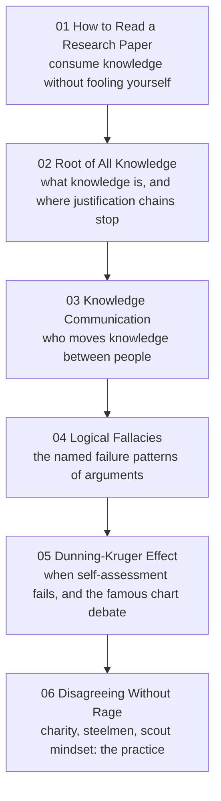

# Meta-Learning: How to Learn and Argue Well

> **Created:** 2026-10-13
> **What this is:** the front door of the meta-learning series. It started with one question ("How do I read a research paper without fooling myself?") and grew into how knowledge works, how it moves between people, how reasoning fails, and how to disagree well. Six notes, one chain.
> **Reading order:** 01 to 06, top to bottom. The wikilinks connect everything, so any entry point works.

## The chain

## The notes

| # | Note | The question it answers |
|---|---|---|
| 01 | [[01_how-to-read-a-research-paper]] | How do I read a paper (or anything) without fooling myself? |
| 02 | [[02_root-of-all-knowledge]] | What is knowledge, and where do chains of justification stop? |
| 03 | [[03_knowledge-communication]] | Who moves knowledge from the people who make it to the people who need it? |
| 04 | [[04_logical-fallacies]] | What are fallacies, really, and how do I keep them out of my own reasoning first? |
| 05 | [[05_dunning-kruger-effect]] | How bad are we at judging our own competence, and what does the famous graph actually show? |
| 06 | [[06_disagreeing-without-rage]] | How do I disagree so it becomes learning instead of a fight? |

## How this series works

- Every note has the same shape: **The question** at the top, a TL;DR, numbered sections, Knowledge connections, and Key takeaways.
- All notes carry the tag **#meta-learning**: search the tag to find them from anywhere in the vault.
- Files are numbered in reading order; new notes append as 07, 08, ... when a real question appears (not on a schedule).

## Candidate notes (a menu, not a plan)

- **Learning science:** spacing, retrieval practice, the generation effect: how to actually study.
- **Note-taking as thinking:** why notes like these change what you understand, not just what you store.
- **Cognitive biases overview:** Dunning-Kruger is one bias; the zoo has a full wing.
- **Writing to learn:** explaining as a comprehension test.
- **Teaching to learn:** if you can teach it, you understand it (the PCK thread from [[03_knowledge-communication]]).

## Knowledge connections

- [[01_how-to-read-a-research-paper]]: the origin question of the whole chain.
- [[02_root-of-all-knowledge]]: the philosophical foundation underneath every other note.
- [[03_knowledge-communication]]: the bridge from personal knowledge to shared knowledge.
- [[04_logical-fallacies]] and [[05_dunning-kruger-effect]]: the two failure modes (reasoning and self-assessment).
- [[06_disagreeing-without-rage]]: the practice that puts the whole chain to work.

## Key takeaways

- The series is one question followed honestly: read, know, communicate, fail, recalibrate, disagree.
- Reading order is a suggestion; the links are the actual map.
- New notes join when a real question appears, not to fill a syllabus.
