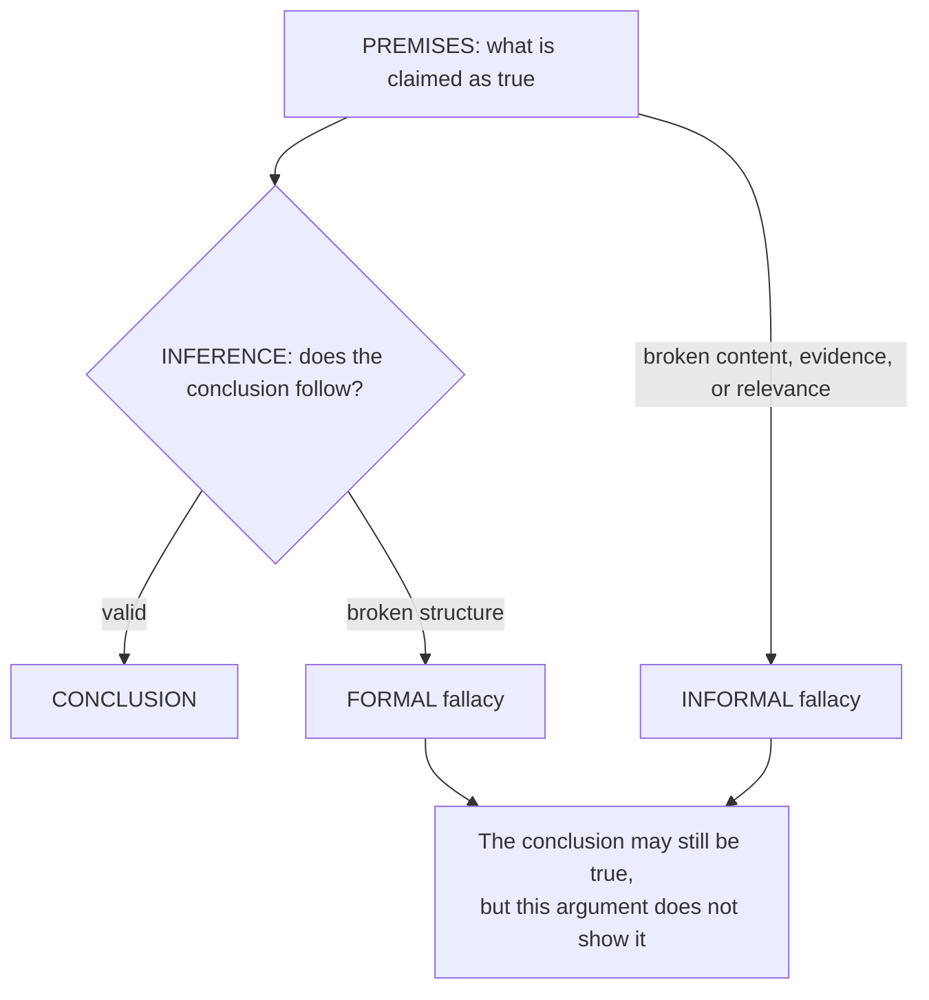
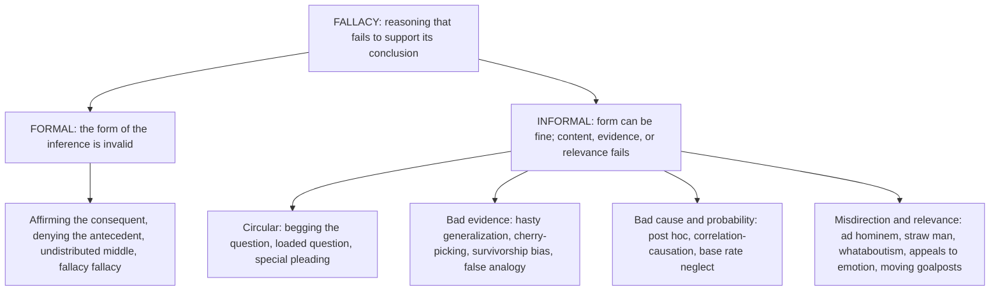

# Logical Fallacies: The Failure Patterns of Arguments

> **Created:** 2026-10-13
> **Grew out of:** [[01_how-to-read-a-research-paper]] (checking a paper's claims) and [[03_knowledge-communication]] (getting knowledge across to other people). This note is about the third act: what happens when two people disagree out loud, and the disagreement either stays a debate or turns into a fight.
> **The question:** "How do we handle a disagreement without any rage? I believe it is called logical fallacy." What are fallacies really, and how much of the answer do they actually hold?

## TL;DR

A **fallacy** is reasoning that fails to support its conclusion. Two facts make fallacies tricky:

1. A fallacious argument can still have a **true conclusion**. The defect is in the reasoning, not automatically in the claim.
2. A fallacy can look exactly like a good argument. That is what makes it dangerous, and why the same move can be a fallacy in one context and perfectly fine in another.

The catalog splits into **formal** fallacies (the structure of the inference is invalid) and **informal** fallacies (structure is fine, but the premises, evidence, relevance, or context fail). The catalog is old (Aristotle) and stable: roughly 30 patterns cover most real cases. But there are two traps: the **fallacy fallacy** (a bad argument does not make the conclusion false), and the social trap: naming a fallacy at your opponent almost never wins the argument and usually starts the rage. The honest use of this catalog is on your own reasoning first. For the full "disagree without rage" toolkit, see [[06_disagreeing-without-rage]].

## 1. What a fallacy is, and how to see one

An argument is not a fight. It is a structure: **premises** (what is claimed as true), linked by an **inference** ("therefore"), pointing at a **conclusion**. Evaluating it takes two questions, in order:

1. **If the premises were true, would the conclusion follow?** (Is the form valid?)
2. **Are the premises actually true?** (Is the content sound?)

A fallacy is a failure somewhere in that chain, and it can fail at either question:

The academic definition: a fallacy is "an error in reasoning that undermines an argument's support for its conclusion." And the deceptive part: "fallacious arguments usually have the deceptive appearance of being good arguments." For most fallacious forms, a similar but non-fallacious instance exists. That is why context decides, and why spotting a fallacy is a judgment call, not a lookup.

Also note the two sources: some fallacies are **deliberate** (manipulation, rhetoric, sales), but most are **unintentional** (carelessness, cognitive bias, ignorance). That matters for the rage question: the person across from you is usually not a villain; they are running a habit.

## 2. The two families

| | Formal fallacy | Informal fallacy |
|---|---|---|
| What fails | The structure of the inference | The content: premises, evidence, relevance, context |
| How to check | Swap the topic, keep the structure: if it breaks, the form is invalid | Requires judgment: facts, context, purpose |
| Classic example | "If it rained, the street is wet. The street is wet. Therefore it rained." | "She is not a doctor, so her point about nutrition is wrong." |
| Where it lives | Mathematics, statistics, contracts, code logic | Everyday argument, politics, meetings, group chats |

On the first row: the street could also be wet from a sprinkler. The conclusion may be true, but this argument does not establish it. That single sentence is the seed of the fallacy fallacy (Section 5).

## 3. The field guide

You do not need to memorize these. Notice the families, because the last group is where most rage-filled disagreements live.

### 3.1 Formal fallacies (the structure itself is broken)

| Fallacy | The broken move | Quick example |
|---|---|---|
| Affirming the consequent | If A then B; B is true; conclude A | "If the deploy broke it, the site is down. The site is down, so the deploy broke it." |
| Denying the antecedent | If A then B; A is false; conclude B is false | "If it rained, the ground is wet. It did not rain, so the ground cannot be wet." |
| Undistributed middle | A is B; C is B; conclude A is C | "All cats are mammals; all dogs are mammals; therefore all cats are dogs." |
| The fallacy fallacy | The argument for X is bad; conclude X is false | "Your analogy was weak, so your whole proposal is wrong." |

### 3.2 Circular reasoning (the premise is the conclusion in disguise)

| Fallacy | The broken move | Quick example |
|---|---|---|
| Begging the question | Assumes the conclusion as a premise | "This app is the best because no app is better than it." |
| Circular argument | X because Y; Y because X | "The document is authentic because it says so, and we know it says so because it is authentic." |
| Loaded question | Smuggles an unproven premise into a question | "Have you stopped ignoring user feedback?" |
| Special pleading | Requests an exemption without giving a reason | "Deadlines apply to everyone, but our team's case is special." |

### 3.3 Bad evidence and bad generalizations

| Fallacy | The broken move | Quick example |
|---|---|---|
| Hasty generalization | Conclusion from a small or unrepresentative sample | "Our first two users churned: the product is doomed." |
| Anecdotal evidence | A story replaces data | "My uncle smoked for 60 years, so smoking is not really dangerous." |
| Cherry-picking | Only the supporting cases are shown | "The model is great: look at these three benchmarks." (the three it passes) |
| Survivorship bias | Only the survivors are visible | "Successful founders dropped out; a degree is unnecessary." (the dropouts who failed are invisible) |
| No true Scotsman | Rescues a generalization by redefining membership | "No engineer would ship that." / "He did." / "Then he is no true engineer." |
| False analogy | The analogy's relevant structure does not match | "Managing a country is just like managing a household budget." |
| Texas sharpshooter | Draws the target around the cluster after the shot | "The numbers spike right at our launch" (found after scanning every possible correlation) |

### 3.4 Cause and probability

| Fallacy | The broken move | Quick example |
|---|---|---|
| Post hoc | After it, therefore because of it | "We changed the font; sales rose. The font did it." |
| Cum hoc / correlation is not causation | Together, therefore caused by | "Ice cream sales and drownings rise together" (summer causes both) |
| Wrong direction / common cause | Causality reversed or shared | "People who take vitamins are healthier, so vitamins cause health." (healthier people take vitamins) |
| Single cause | One cause assumed for a many-cause effect | "The outage was caused by that one commit." (config, load, and timing each played a part) |
| Gambler's fallacy | Independent events owe you a reversal | "Black came up five times; red is due." |
| Base rate neglect | Prior probability ignored | "This test is 99% accurate, so a positive means a 99% chance." (depends on how rare the thing is) |

### 3.5 Misdirection and relevance (the disagreement-killers)

These do not attack the argument at all. They distract from it, attack the person, or change the subject. This is where most rage lives.

| Fallacy | The broken move | Quick example |
|---|---|---|
| Ad hominem | Attacks the person instead of the claim | "She is not even a doctor; ignore her nutrition point." |
| Straw man | Refutes a distorted version of the claim | "You want more tests? So you think we should ship nothing." |
| Tu quoque / whataboutism | "You do it too" | "You say we should document more, but your own notes are a mess." |
| Appeal to authority | Status replaces evidence | "This influencer says the supplement works." (citing a relevant expert together with their evidence is fine; treating status alone as proof is not) |
| Appeal to emotion | Fear, pity, or ridicule replaces reasons | "Think of the children" used as the entire argument. |
| Appeal to popularity | Many believe it, so it is true | "Everyone uses microservices, so microservices must be right." |
| Appeal to ignorance | Not disproven, so true (or not proven, so false) | "No one has proven the risk is real, so it is safe." |
| Moving the goalposts | The standard of proof quietly rises | Evidence given, then "but is it peer-reviewed?", then "but is it replicated?", then "but does it apply to us?" |
| Bulverism / motive attack | Dismisses a belief via the believer's motives | "You only push remote work because you like staying home." |
| Genetic fallacy | The origin of an idea discredits it | "That practice came from a competitor, so it must be wrong." |
| Relative privation | "Worse problems exist" | "Why discuss code quality when people are losing their jobs?" |
| Tone policing | Attacks the delivery instead of the content | "You are too upset to discuss this." |
| Nirvana fallacy | Rejects a solution for not being perfect | "If it does not scale to a billion users, why build it?" |
| Thought-terminating cliche | A phrase that ends thought | "It is what it is." |

Note the straw man's quieter siblings: the **weak man** (pick the worst defender of a position and refute them as if they were the standard), the **hollow man** (invent a position nobody holds: "some say..."), and **nutpicking** (parade the craziest member of a group as representative).

## 4. Where the list comes from

- **Aristotle** (c. 350 BCE), *Sophistical Refutations*: the first systematic catalog. Thirteen fallacies, split into linguistic (errors in how you talk) and non-linguistic (errors in what you are talking about). His stated purpose: "to make it easier to refute an opponent's thesis and thus win an argument." We inherit the list, and the ambiguity about its purpose.
- **India**, the *Nyaya Sutras* (composed between roughly the 6th century BCE and the 2nd century CE): five ways a reason can fail, including *asiddha* (the reason is unproved), *savyabhichara* (the reason is irregular, it overreaches), *satpratipaksa* (the reason is counterbalanced by an equally strong opposite reason), *badhita* (the reason is contradicted by direct perception), and *viruddha* (the reason proves the opposite of what it claims).
- **Richard Whately** (1826), *Elements of Logic*: defines a fallacy broadly as any argument, or apparent argument, which seems decisive of the matter at hand while in reality it is not.
- **Modern argumentation theory**: in the pragma-dialectical view, a fallacy is a move that violates the rules of a fair discussion between people trying to resolve a difference of opinion. This is the frame that matters here: a fallacy is not just a logic error, it is a breakdown in the *conversation*.

The lesson from the history: the list has always had two uses, attacking opponents and keeping yourself honest. The second use is the one that fits the "no rage" goal.

## 5. The two traps

**Trap 1: the fallacy fallacy.** Refuting the *argument* refutes the argument, not the claim. If someone defends a good idea with a bad analogy, the analogy is dead and the idea is untouched. To refute a claim you need a positive case or decisive evidence against it, not just a broken argument for it.

**Trap 2: naming fallacies at people.** Four reasons it backfires:

- **You might be wrong.** Context decides. Appeals to authority, slippery slopes, and analogies all have legitimate forms. A mislabeled "fallacy" costs you credibility.
- **It lands as an attack on the person.** "You committed a fallacy" is heard as "you are stupid". Identity defense engages, and the discussion is over (see [[06_disagreeing-without-rage]]).
- **It does not engage their strongest point.** You shoot at their weakest sentence; they conclude you missed their real case; the argument escalates.
- **It is not even necessary.** The catalog's real power is defensive and internal. It detects when *you* are being moved by bad reasoning, and audits *your* case before you present it.

Before hitting send on a rebuttal, run four questions:

1. Can I state their case better than they did? (If not, I do not understand it yet.)
2. Am I answering their claim, or their tone, their person, their side?
3. Is the move I am about to call out truly fallacious in this context, or is it just uncomfortable?
4. What evidence would change my mind? (If nothing: I am not arguing, I am defending.)

## 6. Thai corner

- The Thai term is **เหตุผลวิบัติ** (the Thai Wikipedia title), also written **ตรรกะวิบัติ**, เหตุผลลวง, ทุตรรกบท. 
- BBC News ไทย's article "รู้จักตรรกะวิบัติ 7 รูปแบบ จับผิดเหตุผลจอมปลอมในทุกสถานการณ์" (Amanda Ruggeri, 13 July 2024) covers seven patterns with Thai examples: อ้างว่าพิสูจน์ไม่ได้ (กิ้งก่าครองโลก), โจมตีตัวบุคคล, อ้างเหตุผลแบบลื่นไหลไปเรื่อย, หุ่นฟาง, อ้างผู้มีอำนาจ, ทางเลือกลวง, and เปลี่ยนเรื่อง-ย้อนกล่าวหา. It supplies the Thai word play for steelmanning: **มนุษย์เหล็กกล้า**.
- The article's own closing advice matches Section 5: the most important place to guard against fallacies is your own reasoning (การเฝ้าระวัง...ในความคิดของตนเอง), and only then does it help steer a discussion back to the actual issue.
- Worth keeping separate in Thai: เห็นต่าง (to disagree) is not ทะเลาะ (to quarrel). The first is a fact of life; the second is a choice about method.

## 7. Where this fits the series

- [[01_how-to-read-a-research-paper]]: its Sections 10 and 11 (threats to validity, trust-but-verify) are the paper-reading version of fallacy-hunting. Same instinct, aimed at documents instead of people.
- [[02_root-of-all-knowledge]]: knowledge lives by error-correction. This catalog gives the error patterns names, but error-correction only works when it is aimed at ideas, not at people.
- [[03_knowledge-communication]]: most fallacies do their work when the audience cannot check the reasoning. Good communication is the immune system.
- [[05_dunning-kruger-effect]]: why the person committing a fallacy often sincerely believes they are reasoning well, and why "you are just Dunning-Kruger" is itself a bad move.
- [[06_disagreeing-without-rage]]: the practitioner's companion: what to do instead of shouting "fallacy".

Cross-vault, in your Philosophy series:

- [05 Aristotle](https://github.com/oat431/general-knowledge/tree/main/Philosophy/05_Aristotle.md): where the list began, in *Sophistical Refutations*.
- [17 Analytic Philosophy](https://github.com/oat431/general-knowledge/tree/main/Philosophy/17_Analytic_Philosophy.md): the home of formal logic, the machinery behind the formal half of the catalog.
- [03 Socrates and the Socratic Method](https://github.com/oat431/general-knowledge/tree/main/Philosophy/03_Socrates_and_the_Socratic_Method.md): the ancestor of "ask, do not attack".

## Sources and further reading

- Wikipedia, "List of fallacies": the backbone taxonomy used in Section 3. https://en.wikipedia.org/wiki/List_of_fallacies
- Wikipedia, "Fallacy": the definition, the Aristotle and Indian history, Whately, and the pragma-dialectical reframe. https://en.wikipedia.org/wiki/Fallacy
- Wikipedia, "Straw man": straw man variants (weak man, hollow man, nutpicking) and steelmanning. https://en.wikipedia.org/wiki/Straw_man
- Aristotle, *Sophistical Refutations* (c. 350 BCE): thirteen fallacies, linguistic vs non-linguistic.
- Richard Whately, *Elements of Logic* (1826): the broad definition of a fallacy.
- Charles L. Hamblin, *Fallacies* (1970): the landmark modern treatment that restarted fallacy studies.
- Amanda Ruggeri, "รู้จักตรรกะวิบัติ 7 รูปแบบ จับผิดเหตุผลจอมปลอมในทุกสถานการณ์", BBC News ไทย, 13 July 2024. https://www.bbc.com/thai/articles/cpd9447v1pdo
- Purdue OWL, "Logical Fallacies": classroom examples for teaching. https://owl.purdue.edu/owl/general_writing/academic_writing/logic_in_argumentative_writing/fallacies.html

## Knowledge connections

- [[01_how-to-read-a-research-paper]]: document-side critical reading; this note is conversation-side.
- [[02_root-of-all-knowledge]]: explains why error-correction is the only engine knowledge has.
- [[03_knowledge-communication]]: weak translation is where fallacies feast.
- [[05_dunning-kruger-effect]]: the confidence half of the story: bad reasoning rarely feels bad.
- [[06_disagreeing-without-rage]]: the practical handbook this note feeds into.

## Key takeaways

- A fallacy is broken support. Check two things: does the inference hold, and are the premises true.
- Formal fallacies break the structure; informal fallacies break the content, evidence, or relevance. Real-life rage lives mostly in the informal group, especially misdirection and relevance.
- A fallacious argument can still have a true conclusion. Refuting the reasoning refutes the reasoning only.
- The catalog's honest use is self-directed first: audit your own case before attacking theirs.
- Naming fallacies at people rarely persuades and usually escalates. Describe the problem inside the argument, address the strongest version of their case, or leave it alone.
- The full method for disagreement without rage is in [[06_disagreeing-without-rage]].
