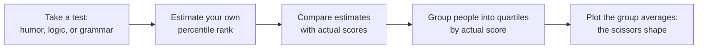
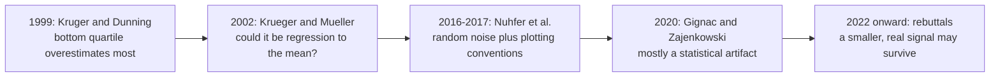

# The Dunning-Kruger Effect: The Study, the Meme, and the Fight Over the Graph

> **Created:** 2026-10-13
> **Grew out of:** [[01_how-to-read-a-research-paper]] (Section 11: trust, but verify) and the same conversation as [[04_logical-fallacies]]: after seeing the famous graph in video essays and defenses, the reaction was "I don't believe we could measure knowledge by a graph."
> **The question:** People cite the "Dunning-Kruger effect" everywhere, always with the same graph. What did the research actually show? And can a graph really measure knowledge?

> "Not knowing the scope of your own ignorance is part of the human condition. The problem with it is we see it in other people, and we don't see it in ourselves. The first rule of the Dunning-Kruger club is you don't know you're a member of the Dunning-Kruger club."
> (David Dunning, 2019 interview)

## TL;DR

The 1999 paper by Kruger and Dunning showed that in tests of humor, logic, and grammar, the **lowest scorers overestimated their performance the most**, while the top scorers slightly underestimated theirs. The proposed reason is metacognitive: the skills needed to do a thing are the same skills needed to judge the thing. That core finding is real, narrower than the meme, and worth knowing.

Everything famous *around* it is contested:

- The viral **"Mount Stupid" curve** (peak, crash, slow climb) appears **nowhere in the paper** or in any of the researchers' follow-up work. It is a mid-2000s invention with no empirical basis.
- The classic **scissors chart** can be produced by pure statistics: regression to the mean plus the better-than-average effect, with no Dunning-Kruger effect present (Krueger and Mueller 2002; Nuhfer et al. 2016-2017; Gignac and Zajenkowski 2020).
- When the better statistical tests were run on real data, the effect **shrank toward zero** in the domain tested (intelligence: 929 participants, no significant effect).

So the skepticism in the question is half right, and worth sharpening: **the graph does not measure knowledge.** It plots a self-report (a feeling, expressed as a percentile) against one test score in one domain. The honest version of this note: keep the metacognition lesson, drop the mountain, and never use it as a label for other people (that would itself be a fallacy: see [[04_logical-fallacies]]).

## 1. What the 1999 paper actually did

Justin Kruger and David Dunning, *"Unskilled and Unaware of It: How Difficulties in Recognizing One's Own Incompetence Lead to Inflated Self-Assessments"* (Journal of Personality and Social Psychology, 1999). Four studies, built on the story of McArthur Wheeler, the 1995 bank robber who thought rubbing lemon juice on his face made him invisible to cameras.

The domains: **Study 1** humor (rate jokes, compare against professional comedians), **Study 2** logical reasoning (LSAT-style problems), **Study 3** English grammar, **Study 4** logical reasoning again, this time with a training intervention.

The headline numbers: the **bottom quartile** of performers actually scored around the **12th percentile** but estimated themselves around the **58th to 68th percentile** depending on the study. The top quartile, whose test performance put them in the **86th percentile**, estimated themselves only around the **68th to 74th**. Bottom performers overestimated the most; top performers slightly underestimated.

The proposed mechanism, in the paper's own words: "the skills that engender competence in a particular domain are often the very same skills necessary to evaluate competence in that domain." If you cannot produce a grammatical sentence, you also cannot reliably tell a grammatical sentence from an ungrammatical one, including your own. Hence the paper's title, and the "dual burden": low performers carry both the lack of skill and the lack of ability to notice it. Darwin had said it more colorfully in 1871: "ignorance more frequently begets confidence than does knowledge."

One more part almost everyone forgets, and it is the most useful part: **Study 4 gave participants training**, and improving their actual skill improved their self-assessment. The calibration followed the competence. More on this in Section 4.

Scope check: this was about **self-assessment accuracy in specific skills**, in one population (Cornell undergraduates), not a claim about intelligence in general or about "stupid people." The paper's own first footnote says incompetence is a matter of degree and domain-specific. That nuance did not survive the meme.

## 2. What the famous graph actually shows

The graph everyone shares is a two-line chart: perceived ability vs actual ability, grouped into four quartiles of actual performance. The two lines cross: below the crossing the group average overestimates, above it underestimates. That is the "scissors."

What it is:

- **Four data points per line.** It plots quartile averages, not individual people, not a curve over time.
- The x-axis is **performance level** (how good you are), never experience or time.
- A **questionnaire result**: "where do you think you rank compared to your peers?" plotted against test score. It measures a feeling vs a performance.

What it is not:

- **Not a mountain.** The viral curve (Peak of Mount Stupid -> Valley of Despair -> Slope of Enlightenment -> Plateau of Sustainability) does not appear in the 1999 paper, in Dunning's later research, or in any primary study. Its exact origin is murky; it spread through mid-2000s management and internet culture, plausibly blended with the Gartner hype cycle (Chou 2026). There is no peak-and-crash in the actual data: the pattern is monotonic, not a mountain.
- **Not "novices are as confident as experts."** In the real data, low performers overestimate *their gap*, but their confidence is still **lower** than the confidence of top performers. The meme flattens this into "the incompetent are maximally confident," which is a different, unsupported claim.
- **Not about intelligence.** It is about specific skills, measured at a specific moment, in specific tasks.

This is why the effect is often re-described as a metacognition finding: not "dumb people are confident" (popular culture's version, and the reason it is a favorite insult) but "self-evaluation is a skill, and it is missing exactly where the skill it evaluates is missing."

## 3. The critique: can the scissors appear from noise?

This is where your instinct ("you cannot measure knowledge like that") gets academic backup.

### 3.1 Regression to the mean and the better-than-average effect

Two statistical facts were pointed out early (Krueger and Mueller, 2002; a different Krueger from the co-author, the footnote in the 2020 paper warns about the confusion):

1. **Regression to the mean.** Self-assessed ability and measured ability correlate only weakly (meta-analytic estimates hover around r = 0.29 to 0.33). When two imperfectly correlated measures are compared, extreme values on one tend to look less extreme on the other. So people who genuinely scored at the bottom will, on average, have *self-ratings that sit closer to the middle*. Part of the "overestimation" is arithmetic, not psychology.
2. **The better-than-average effect.** Most people rate themselves above average on most things. The average self-reported IQ is around 115, and only a few percent of people rate themselves below average. Add this flat upward bias to regression, and the quartile plot tilts exactly like the scissors.

### 3.2 The simulations that broke the chart

- **Gignac and Zajenkowski (2020)** simulated data containing *only* those two artifacts, no Dunning-Kruger effect, and reproduced the iconic chart. Then they built a valid test: if low performers are truly worse at self-assessment, the residuals of self-rating regressed on performance should get wider toward low performance (heteroscedasticity), and the relationship should bend (a quadratic trend). On real data (929 community participants; Raven's progressive matrices; self-rated intelligence), neither appeared: "we failed to identify statistically significant heteroscedasticity" and the association was "essentially entirely linear." Their conclusion: the effect "may be much smaller than reported previously."
- **Nuhfer and colleagues (2016, 2017)**, using random-number simulations and a careful paired dataset (N = 1,154, science literacy), showed that "graphical conventions common in the self-assessment literature introduce artifacts that invite misinterpretation." With properly aligned instruments, self-assessments reflected a competence people could actually demonstrate. In their reading, the label "unskilled and unaware of it" applies to very few people.
- A smaller point with large consequences: the famous quartile plot itself is a lossy visualization. Chopping continuous data into four bins, then comparing averages, is a well-known generator of illusions.

### 3.3 The debate today

The critique did not end the discussion. Dunning has defended the work: purely statistical explanations, he argues, fail to account for key findings, and misjudgment is real regardless of its cause (Dunning 2022). McIntosh and colleagues frame the current compromise as "noise plus bias": some genuine metacognitive signal exists, overlaid with statistical artifacts; one study found unskilled people mainly lack information while their metacognitive machinery is fine. Cross-cultural work (Heine and colleagues, 1999, and later replications) found the pattern weaker or even reversed in East Asian samples. And domain matters: the effect replicates best where people have a vivid sense of what "good" looks like (humor, grammar) and weakly in foggy domains like medical decisions under uncertainty.

> Status claim to keep: the *meme* is dead in the literature; the *modest phenomenon* is contested; the *metacognition lesson* is alive.

## 4. What actually survives

Three things, all more useful than the meme:

1. **Self-assessment is weak evidence of ability.** The correlation between what people think they can do and what they actually can do is around 0.3. That applies to you too: the feeling of understanding a topic is a noisy signal. This is the quiet reason paper-note writing exists ([[01_how-to-read-a-research-paper]], Section 14): explaining in your own words is a self-assessment with the noise squeezed out.
2. **Calibration is teachable, not a personality trait.** Study 4 in the original paper: train the skill, and self-assessment moves toward reality. Nuhfer's education work agrees: self-assessment skill is "valuable, measurable, and teachable." If you want people (or yourself) to judge performance better, give them feedback loops and skill, not lectures about humility.
3. **The top-performer side has its own distortion.** High performers who underestimate often do it because they assume others find the task as easy as they do (a false-consensus effect): they project their competence onto the average. The expert sees the distance from their performance to the ideal; the beginner sees only that it worked. Both ends of the scissors are self-knowledge problems.

For practical significance, the literature points at career counseling, piloting, medical training, and any system that asks people to rate their own skills (self-assessments "often do not correspond to the underlying skills" as data). Conversely, the effect's popular weaponization ("you are so Dunning-Kruger") is neither diagnostic nor kind, and usually wrong about the mechanism.

## 5. Answering the original question: can you measure knowledge with a graph?

No. And unpacking why is where the skepticism becomes precise:

- **The y-axis is not knowledge; it is a self-report.** It is a feeling ("where do I rank?") converted into a number. Feelings are data, but they are data about the person, not about the knowledge.
- **The x-axis is not knowledge either; it is performance on one instrument.** One test, one domain, one sitting. Test performance is a sample from the skill, with its own measurement error, contamination, and construct-validity problems. This is exactly the "construct validity" question from [[01_how-to-read-a-research-paper]] Section 10: does the measure capture the concept? Here the chart quietly renames "self-rated percentile" as "perceived knowledge" and "test score" as "actual knowledge." Neither rename survives scrutiny.
- **"Knowledge" is not one quantity.** Declarative vs procedural, recognition vs recall, understanding vs fluency, domain-specific vs transferable: these do not collapse into a single axis. A graph needs one dimension; knowledge refuses to be one dimension. That is the honest core of the original objection.
- **And even the pattern itself is contested** (Section 3): part of the shape of the chart is manufactured by the plotting method.

So the correct reading of the chart is: "here is a way some self-reports misalign with some test scores, with heavy caveats," not "here is the graph of knowledge." If you want to measure your own knowledge in practice, the working instruments are unglamorous: can you explain it (generation effect), can you predict outcomes, does feedback confirm you, can you teach it. The graph never measured knowledge; the memes just made it look like it did.

## 6. Using it without becoming the fallacy police

- **Never diagnose other people with it.** "You are Dunning-Kruger" is, at best, a circumstantial ad hominem dressed as science ([[04_logical-fallacies]], Section 3.5). It also mislabels: the effect is about self-assessment on a specific measured skill, not about who is worth listening to.
- **Do use it as a mirror.** The one-sentence version to remember: *the feeling of competence is produced by the same machinery that produces the competence, so it fails exactly where it is needed.* Practical checks: explain the thing to someone else; predict the result before looking; ask "what would make me say I was wrong?"; and prefer feedback over introspection.
- **Use it as an educator's tool.** Calibration improves with training and feedback (Study 4; Nuhfer). The actionable version for teaching is not "let them feel the valley" (that is meme logic) but "teach the skill and build feedback loops; calibration follows."
- **Keep the epistemics, drop the insult.** The serious content behind this meme is: confidence is cheap, calibration is expensive, and the only trustworthy way to know what you know is repeated contact with reality.

## 7. Thai corner

- The Thai name is **ปรากฏการณ์ดันนิง-ครูเกอร์** (see th.wikipedia, "ปรากฏการณ์ดันนิง-ครูเกอร์"). Thai social media uses it much like English social media: mostly as the insult version (the mountain meme), rarely as the study version.
- If you cite it in Thai writing, cite the narrow version ("people are worst at judging skills they have not yet built") and skip the mountain entirely. The Thai Wikipedia article tracks the same story as the English one: the effect, the criticisms, the debate.

## 8. Where this fits the series

- [[01_how-to-read-a-research-paper]]: this note is a case study in its Section 11 ("trust, but verify") and Section 10 (construct validity): a peer-reviewed finding, a popular mutation, a statistical artifact, a defense, and a live debate: the full life of a claim.
- [[02_root-of-all-knowledge]]: "judge knowledge by how it handles error, not by how certain it sounds." The Dunning-Kruger story is that principle applied to psychology itself: the field's error-correction loop, visible in action.
- [[04_logical-fallacies]]: the label version of this effect is a fallacy in daily use; and the fallacy fallacy applies to the critique too (a flawed chart does not void the metacognition insight, and vice versa).
- [[06_disagreeing-without-rage]]: humility about your own calibration is the quiet foundation of arguing well.

## Sources and further reading

- Justin Kruger and David Dunning, "Unskilled and Unaware of It: How Difficulties in Recognizing One's Own Incompetence Lead to Inflated Self-Assessments," *Journal of Personality and Social Psychology* 77(6), 1999. https://sites.lsa.umich.edu/sasi/wp-content/uploads/sites/275/2015/11/krugerdunning99.pdf (the original paper; open PDF)
- Gilles E. Gignac and Marcin Zajenkowski, "The Dunning-Kruger effect is (mostly) a statistical artefact: Valid approaches to testing the hypothesis with individual differences data," *Intelligence* 80, 2020. https://gwern.net/doc/iq/2020-gignac.pdf (the central critique; simulations plus N = 929 test)
- Edward Nuhfer et al., "How Random Noise and a Graphical Convention Subverted Behavioral Scientists' Explanations of Self-Assessment Data," *Numeracy* 10(1), 2017. https://files.eric.ed.gov/fulltext/EJ1480131.pdf
- Joachim Krueger and Ross Mueller, "Unskilled, unaware, or both? The better-than-average heuristic and statistical regression predict errors in estimates of own performance," *Journal of Personality and Social Psychology*, 2002 (the early critique).
- Wikipedia, "Dunning-Kruger effect": definition, measurement, the explanations (metacognitive, statistical, rational, distributional), and the state of the debate. https://en.wikipedia.org/wiki/Dunning%E2%80%93Kruger_effect
- Yu-kai Chou, "Dunning-Kruger Effect: An S-Tier Behavioral Designer's Guide" (2026): a popular summary of the primary literature, including the Mount Stupid fabrication and the cultural variation findings. https://yukaichou.com/behavioral-analysis/dunning-kruger-effect-incompetence-overconfidence/
- th.wikipedia, "ปรากฏการณ์ดันนิง-ครูเกอร์": the Thai-language version of the same debate.

## Knowledge connections

- [[01_how-to-read-a-research-paper]]: the validity toolkit used here (construct validity, trust-but-verify).
- [[02_root-of-all-knowledge]]: error-correction as the engine of knowledge; this is that principle in a psychology dispute.
- [[04_logical-fallacies]]: "you are Dunning-Kruger" is the fallacy version of this effect.
- [[06_disagreeing-without-rage]]: calibration humility as the foundation of calm disagreement.

## Key takeaways

- The 1999 finding: bottom performers overestimate most, top performers slightly underestimate, and the proposed cause is metacognitive (the skills to do a task are the skills to judge it).
- The "Mount Stupid" curve is not in the paper or any follow-up: it is a meme with no empirical basis.
- The famous scissors chart can be recreated from statistical artifacts alone (regression to the mean plus better-than-average effect); controlled tests found the effect shrinking toward zero in intelligence.
- What survives: self-assessment is a weak signal (r around 0.3), calibration is teachable through skill and feedback, and both ends of the skill distribution have self-knowledge problems.
- You cannot measure knowledge with that graph: one axis is a self-report, the other is one test in one domain, and "knowledge" is not a single dimension.
- Never use it as a label for other people; use it as a mirror for yourself.
