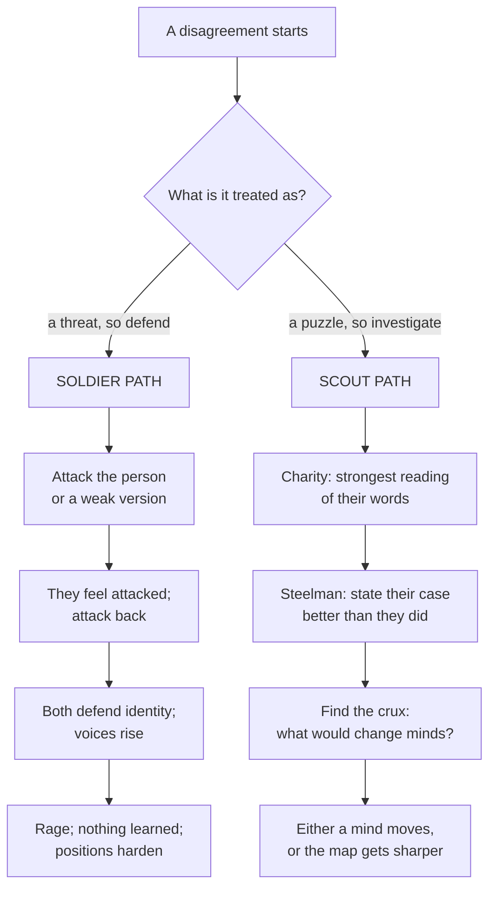

# Disagreeing Without Rage: Charity, Steelmen, and the Scout Mindset

> **Created:** 2026-10-13
> **Grew out of:** [[04_logical-fallacies]] (how arguments break) and [[05_dunning-kruger-effect]] (why confidence misleads). Those two notes explain the machinery of broken disagreement; this one answers the original question from the start of the thread: what do you actually do, in the moment, so that a disagreement does not turn into rage?
> **The question:** "How do we handle the different without any rage?" Two people disagree. Sometimes it becomes a fight; sometimes it becomes learning. What makes the difference, and what can be practiced?

## TL;DR

The difference is not intelligence, politeness, or which side is right. It is the **mode**. When a disagreement is felt as a threat, reasoning switches into **soldier mode**: defend the position, attack the challenger, protect identity; and the fight escalates on its own. When a disagreement is treated as a puzzle, reasoning runs in **scout mode**: map the territory, follow evidence, update. Five practices convert the first into the second:

1. **Charity:** read their words in the strongest reasonable way before reacting.
2. **Steelman:** state their case better than they did, then respond to that version.
3. **Aim at claims, not people:** identities stay out of the line of fire.
4. **Hunt the crux:** find the one fact that would actually change a mind, and talk about that.
5. **Describe, do not label:** "that reason does not reach the conclusion" instead of "that is a fallacy."

One boundary, stated early: this toolkit is for **good-faith disagreement**. Bad faith gets disengagement, not technique. The goal is not fewer disagreements; it is disagreements aimed at ideas, where they can move something and cannot wound anyone.

## 1. Why disagreement turns into rage

Rage does not come from the topic. It comes from what the disagreement is **treated as**. When a claim you hold is challenged, the brain can hear two different things: "here is new information" or "your standing is under attack." In the second reading, the machinery changes: the goal stops being *what is true* and becomes *who wins*. Julia Galef calls this the **soldier mindset**: motivated reasoning in defense of existing beliefs. It is the human default in high-stakes moments, and it has its logic: defending your position protects belonging, status, and self-image. The cost is that none of those are the things a disagreement was supposed to be about.

The escalation has a shape:

Two honest footnotes before the techniques:

- **Anger is information.** It signals that something you value is at stake, or that you feel treated unfairly. Suppressing it is not the goal; letting it navigate is the problem. The skill is feeling the signal, then choosing the path.
- **Identity raises the stakes.** When a belief has become part of who someone is, dislodging it feels like an amputation, and they will defend it like a body part. Sarah's take isn't "GitFlow is a decent pattern"; it is "I am a GitFlow person." The techniques below work because they take the person out of the line of fire.

## 2. The scout mindset

Julia Galef's *The Scout Mindset* (2021) names the alternative: "the motivation to see things as they are, not as you wish they were." The metaphor: a soldier defends territory; a scout goes out to map it, and reports the terrain accurately, including the parts that are inconvenient. The book's five parts are a curriculum for exactly this:

- **The case for the scout.** The soldier mindset overrates defending; the scout systematically gets a better map and better decisions over time.
- **Self-awareness.** Noticing your own biases and labeling confidence levels honestly (a probability, not a vibe).
- **Thriving without illusions.** The suspicion that self-deception is useful (for happiness, motivation, influence) is mostly wrong; there are better ways to get those goods. (This is the healthy cousin of [[05_dunning-kruger-effect]]: confidence is not a strategy.)
- **Changing your mind.** Treat updating as a skill, not a failure. Pay attention to the things that confuse you; confusion is often an assumption breaking. And Galef's specific advice for engaging opposing views productively is the spine of this note.
- **Rethinking identity.** Beliefs fused with identity harden. "Holding your identity lightly" makes changing your mind survivable: you can lose an argument without losing yourself.

Two calibration details from the book's examples, because they puncture the cliche: Galef's model of the scout is not Mr. Spock. The book catalogs Spock's confident forecasts and shows he is wrong *more* the more certain he sounds: confidence is not rationality. And her scout heroes are not contrarians: Georges Picquart was a French officer who worked to exonerate Dreyfus against his own prejudice and his institution; the scout is often someone who updates *against* their own side at real cost.

One fair caveat (Lovett, 2022, in *Psychological Injury and Law*): the scout and soldier modes are a "useful framework," but it is not proven that the scout mode always makes advocates more effective. In some fights, advocacy pays; the claim here is only that *defaulting* to scout mode gives you a truer map, and a truer map eventually wins more fights than confidence does.

## 3. Charity: read them at their strongest

The **principle of charity** (named by Neil L. Wilson, 1958-59; developed by Quine and Davidson) says: interpret a speaker's statement in the most rational way possible. If a coherent, sensible reading exists, use it; do not attribute irrationality, confusion, or fallacies when a reasonable interpretation is available. Davidson's version is the cleanest: "we make maximum sense of the words and thoughts of others when we interpret in a way that optimises agreement." Philosophy needed this rule because interpreting others is unavoidable guesswork; the only question is whether you guess generously or uncharitably.

Four versions of the principle exist, and the differences are practical:

1. Assume they use words in the ordinary way.
2. Assume they say true things (so prefer readings where they are right over readings where they are absurd).
3. Assume they argue validly (hunt for the missing premise that makes their argument work, instead of declaring it broken).
4. Assume they say something interesting (the generous reading is usually the one they actually meant, and it is usually more interesting than the stupid one).

Philosophers have even formalized procedures for this (the "dialectical principle of charity," Sikora and Prus, 2023: a four-step algorithm for critical discussion). The practical translation for daily life is one sentence: **if their sentence sounds stupid, first suspect your parsing, or their wording, or missing context, before concluding their mind.** Ask: "Do you mean X or Y?" before you burn a bridge refuting the wrong X.

Charity is a *default*, not a naivety: when someone repeatedly shows bad faith, stop being charitable and stop the conversation. But you will be surprised how often the charitable reading was the correct one, and how much rage was manufactured by an uncharitable one.

## 4. Steelmanning: the strongest version wins or nothing does

**Steelmanning** is charity in action: constructing the strongest form of the other person's argument, even if they did not present it that way, and then responding to *that*. It is the explicit opposite of the straw man (and the straw man's quieter relatives: refuting the weakest defender of a position, or a position nobody holds). Conor Friedersdorf called it "the highest form of disagreement" (The Atlantic, 2017).

Why it works:

- **Epistemic:** you cannot claim your position survives if it has only survived weak versions. Refuting the strongest version is the only test that means anything. As a bonus, building your counters against the steelman strengthens your own argument.
- **Social:** people defend less when they feel accurately understood. Rage feeds on the sense of being misrepresented; a precise restatement starves it.
- **Practical:** sometimes the steelman wins. That is the point of doing it: you get to update *before* reality makes you.

BBC News ไทย notes it too, in its own words: the best reply to a หุ่นฟาง (straw man) is to build a มนุษย์เหล็กกล้า, restating the other side's thought more clearly and thoroughly than they did, before explaining why you disagree.

The steelman formula, in four steps:

1. "The strongest case I can see for your position is..." (state it, charitably, specifically).
2. "Is that what you mean?" (let them confirm or correct; if they correct you, you just learned something).
3. "Here is my response to *that* version." (now your rebuttal is aimed at something real).
4. "What would change your mind about it?" (bridge to Section 5).

## 5. The practical toolkit

Small, learnable moves; pick two to practice first.

1. **Ask before you assert.** Questions move a conversation forward; assertions collide. "What led you to that?" "How would that work when X happens?" This is the Socratic method, and your Philosophy vault has its origin story: [03 Socrates and the Socratic Method](https://github.com/oat431/general-knowledge/tree/main/Philosophy/03_Socrates_and_the_Socratic_Method.md).
2. **Mirror before you respond.** State their position back, in your own words, until they say "yes, that is what I mean." Unconfirmed understanding is not understanding; and this single move defuses more fights than any argument does.
3. **Aim at claims, not people.** "That argument does not cover case X" lands; "you always..." does not. Keep beliefs as hypotheses, not territory. If you notice yourself defending a self-image ("I am not the kind of person who..."), stop and re-locate the actual claim.
4. **Find the crux.** A **crux** is the fact that, if you believed differently about it, would change your conclusion: in a **double crux**, one that would change both sides. Instead of trading twenty arguments, hunt for the one fact that actually matters: "Would it change your view if the benchmark were replicated independently?" / "It would change mine if..." This is a known technique from the rationality community (CFAR; Duncan Sabien), and it converts a fight into joint fact-finding. Caveats: it needs good faith (do not double-crux with someone performing rather than inquiring), and it cannot resolve pure values clashes (no fact moves "blue vs green").
5. **Describe, do not label.** "That is a straw man" is a fight; "I did not claim that; let me restate the smaller thing I did claim" is a repair. The catalog in [[04_logical-fallacies]] is for auditing your own case first; in public, name the *problem in the argument* in plain words, not the Latin classification.
6. **Let the body calm before the words move.** Rage is physiological: heart rate up, breathing shallow. If you notice it (yours or theirs), slow down; write instead of speak if needed. A five-minute pause has saved more conversations than great rhetoric.
7. **Know the exit conditions.** Disengage when you detect bad faith, when you are repeating your last argument, or when the disagreement is actually a values conflict that facts cannot settle. Leaving the fight is not losing the argument; it is refusing to play the wrong game.

## 6. What this does not mean

- **Charity is not credulity.** You can still conclude they are wrong, and say so. You just read them correctly first.
- **Steelman is not surrender.** Presenting their strongest case costs you nothing and sharpens the case for your own.
- **Scout is not spinelessness.** The scout mindset is not "no opinions"; it is "opinions that can be revised by evidence." Galef's own examples are people who acted decisively, against hard pressure.
- **This is not conflict avoidance.** Suppressing disagreement to keep the peace is the opposite of the goal; the goal is disagreement that is well-aimed. Precision is sharper than rage, and it is the reason the "no rage" version often wins.

## 7. Thai corner

- The BBC News ไทย piece on ตรรกะวิบัติ supplies the local term for the steelman move: **มนุษย์เหล็กกล้า** (steel man), "restate the other side's idea more clearly and in more detail than they did, before you explain why you disagree."
- Useful distinction to keep in Thai and in life: เห็นต่าง (to see differently) is not ทะเลาะ (to quarrel). The first is a fact of life and half of how knowledge grows; the second is a choice about method.
- The whole note compresses into one Thai sentence: เข้าใจก่อน แล้วค่อยโต้แย้ง (understand first, then argue).

## 8. Where this fits the series

- [[04_logical-fallacies]]: the catalog of broken arguments; this note is the etiquette and method for using it without causing rage.
- [[05_dunning-kruger-effect]]: calibration humility; believing you might be the miscalibrated one is the quiet foundation of calm disagreement.
- [[01_how-to-read-a-research-paper]]: reading is disagreement with authors at a distance; the three-pass method is charity applied to documents (understand before you judge).
- [[02_root-of-all-knowledge]]: error-correction needs criticism; this note is about criticism that people can survive and use.
- [[03_knowledge-communication]]: disagreements are where communication gets stress-tested.

## Sources and further reading

- Julia Galef, *The Scout Mindset: Why Some People See Things Clearly and Others Don't* (Portfolio, 2021). Summary and reception: https://en.wikipedia.org/wiki/The_Scout_Mindset
- Benjamin J. Lovett, "Objectivity or Advocacy? The Ethics of the Scout Mindset in Psychoeducational Assessment," *Psychological Injury and Law* 15(3), 2022 (the caveat cited in Section 2).
- Wikipedia, "Principle of charity": Wilson's naming, Quine and Davidson's formulations, the four versions, the dialectical algorithm. https://en.wikipedia.org/wiki/Principle_of_charity
- Wikipedia, "Straw man": steelmanning section and straw man variants. https://en.wikipedia.org/wiki/Straw_man
- Conor Friedersdorf, "The Highest Form of Disagreement," *The Atlantic*, 2017 (the phrase in Section 4, as cited in the Wikipedia steelmanning section).
- LessWrong / CFAR, "Double-Crux" (technique description): https://www.lesswrong.com/tag/double-crux
- BBC News ไทย, "รู้จักตรรกะวิบัติ 7 รูปแบบ จับผิดเหตุผลจอมปลอมในทุกสถานการณ์," 13 July 2024 (มนุษย์เหล็กกล้า). https://www.bbc.com/thai/articles/cpd9447v1pdo

## Knowledge connections

- [[04_logical-fallacies]]: the failure patterns; this note is how to use them without weaponizing them.
- [[05_dunning-kruger-effect]]: why "I might be the miscalibrated one" is not weakness but method.
- [[01_how-to-read-a-research-paper]]: charity applied to documents and authors.
- [[02_root-of-all-knowledge]]: why criticism, not certainty, keeps knowledge alive.
- [[03_knowledge-communication]]: the professional version of communicating across divides.

## Key takeaways

- Rage comes from treating a disagreement as a threat; calm comes from treating it as a puzzle to map. Same facts, different mode.
- Charity first: read their words at their strongest; if the sentence sounds stupid, suspect the parsing before the mind.
- Steelman before you rebut: state their case better than they did, confirm it, then respond to that version.
- Aim at claims, never at identities; keep beliefs as hypotheses, not territory.
- Hunt the crux: find the fact that would change the mind, and spend your energy there.
- Describe problems in the argument; do not recite fallacy names as weapons.
- This is for good-faith disagreement; bad faith gets disengagement, not technique.
- เข้าใจก่อน แล้วค่อยโต้แย้ง: understand first, then argue.
