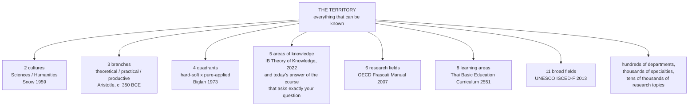
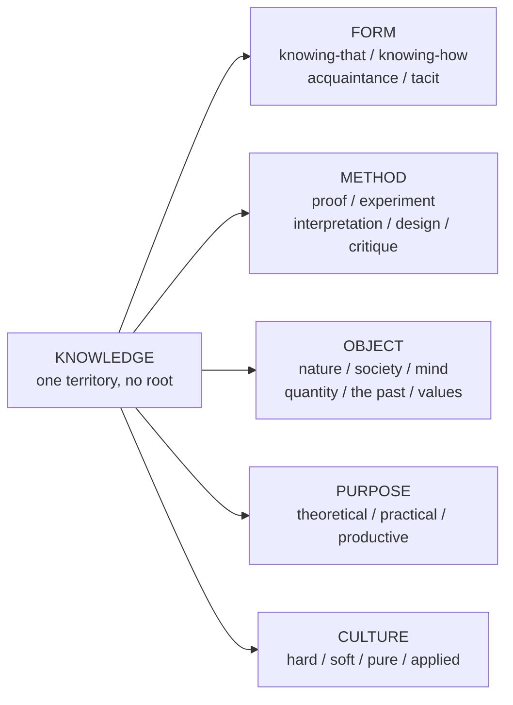

# The Kinds of Knowledge: How Many Are There?

> **Created:** 2026-10-17
> **Grew out of:** [[02_root-of-all-knowledge]], and the question you asked right after reading it: if knowledge has no single root, how many *kinds* of it are there? Science, engineering, social studies, philosophy... what is the full list?
> **The question:** When we say "this is science, this is engineering, this is social studies, this is philosophy," we are cutting knowledge into strands. How many strands are there? Is there a real number?

## TL;DR

There is no real number. The count belongs to the **map**, not to the territory. The same world, honestly described, yields 2 kinds (C.P. Snow), 3 (Aristotle), 4 (Biglan), 5 (the IB theory-of-knowledge course today), 6 (the OECD's research statistics), 8 (the Thai school curriculum), 10 (the Dewey library shelves), 11 (UNESCO's education statistics), 24 (UNESCO's 1973 research nomenclature), and hundreds at university-department level. None of these is wrong. They cut along different **axes**, at different **resolutions**, for different **purposes**.

The best evidence: there is one course in the world whose entire subject is your question, the IB's *Theory of Knowledge*. It used to teach **8** areas of knowledge. Its 2022 rewrite teaches **5**. The same question, the same honest thinkers, a different number. The number is the map's, not the world's.

What *is* real in the territory: the axes. What knowledge is **about** (object), how it is **justified** (method), what it is **for** (purpose), what **shape** it takes (knowing-that vs knowing-how), and how its **practitioners behave** (culture). For your second question, "how do we learn each kind properly?", one axis matters most: the method axis. That is the bridge to the next note.

## 1. First, the word: what to call these things

"Type of knowledge" is not quite a standard term, because English has at least six overlapping words, and each means something slightly different:

| Word | Scope | Example | Where you meet it |
|---|---|---|---|
| **Branch** or **domain** of knowledge | The biggest cuts | science, humanities, philosophy | the question you asked |
| **Discipline** | The institutional unit: a field with departments, journals, degrees | physics, sociology, history | universities |
| **Field** of study | Neutral, size-free; often between domain and discipline | "the field of software engineering" | statistics, CVs |
| **Subject** | What is taught | "mathematics is a subject" | schools |
| **Strand** (สาระการเรียนรู้) | A subdivision *inside* a school subject | Thai language has 5 strands, English has 4 | the Thai curriculum |
| **Epistemic culture** or **tribe** | The community and its habits: how people argue, write, prove | "the culture of pure mathematics" | sociology of science |

The word you were reaching for is **branch of knowledge** or **domain of knowledge**. One caution about "strand": in the Thai curriculum it is a smaller word than you used it. You said "knowledge strands" meaning science vs engineering vs philosophy; the curriculum calls those **กลุ่มสาระการเรียนรู้** (learning areas), and reserves "strand" (สาระการเรียนรู้) for the units *inside* one subject. Both usages are common; being precise about *which level you mean* turns out to matter, because half of the confusion in this whole question is levels-of-resolution confusion.

## 2. Why there is no single number: the maps are stacked

Classifying knowledge is cartography, and cartography has two degrees of freedom: **where you cut** (the axis) and **how finely** (the resolution). Change either and the count changes, without any dishonesty:

The counts side by side, with what each map is actually for:

| Map                                        | Count             | Axis it cuts along                       | What the map is for                |
| ------------------------------------------ | ----------------- | ---------------------------------------- | ---------------------------------- |
| Aristotle's branches of knowledge          | 3                 | what knowing is *for*                    | philosophy                         |
| C.P. Snow's Two Cultures                   | 2                 | mutual comprehension between communities | cultural criticism                 |
| Biglan's clusters (made famous by Becher)  | 4                 | hard/soft x pure/applied                 | studying how disciplines behave    |
| IB Theory of Knowledge, 2022               | 5                 | school subject cultures                  | teaching teenagers epistemology    |
| OECD Frascati Fields of Science            | 6                 | research statistics                      | counting R&D money                 |
| Thai Basic Education Core Curriculum, 2551 | 8                 | school curriculum                        | organizing school time             |
| IB Theory of Knowledge, pre-2022           | 8                 | school subject cultures                  | the same course, an earlier map    |
| Dewey Decimal Classification               | 10                | library shelving                         | finding books                      |
| UNESCO ISCED-F 2013                        | 11                | education statistics                     | comparing degrees across countries |
| UNESCO nomenclature of fields              | 24                | research fields                          | cataloguing R&D projects           |
| University faculties                       | dozens            | profession + knowledge + money           | hiring, degrees, accreditation     |
| Research specialties                       | tens of thousands | research communities                     | journals and careers               |

Three observations from the table alone:

1. **The same axis can give different numbers.** Both TOK rows cut along "school subject cultures," and the answer moved from 8 to 5 in one curriculum rewrite. Even the axis choice does not fix the number; resolution and judgment still do.
2. **Different axes disagree about where the seams are.** Where does computing belong? Dewey shelves it at 000 with information; ISCED gives it its own field (06); the Frascati manual splits it between natural sciences (mathematics, computer and information sciences) and engineering; older TOK maps argued whether it is mathematics or an art. All defensible.
3. **The boundaries are contested by the people who live on them.** The current TOK guide says it plainly: "disputes within disciplines are endless. Should graphic novels be counted as literature? Should anthropology belong to the sciences or to the humanities?" Border disputes are a permanent feature of the territory, not a defect of the maps.

So "how many kinds of knowledge?" has the same logical shape as "how many colors are there?" The spectrum is continuous; the count is a decision about naming. And as with colors, some cuts are more useful than others, depending on what you will do next.

## 3. A different question hiding in the same words: the *shapes* of knowing

Before mapping territories, notice that "types of knowledge" can mean something else entirely: not *what area*, but *what form* the knowledge takes in a knower. Philosophy carved this axis first, and the cuts are genuinely in the territory, not in the map:

| The cut | What it divides | Examples | Source |
|---|---|---|---|
| **knowing-that** / **knowing-how** | propositions vs skills | "Bangkok is in Thailand" vs riding a bicycle | Gilbert Ryle, The Concept of Mind, 1949 |
| **acquaintance** / **description** | direct contact vs mediated reports | seeing red vs "the longest river in Thailand" | Bertrand Russell, 1911 |
| **tacit** / **explicit** | what you can show vs what you can write | a master's craft sense vs a manual | Michael Polanyi, The Tacit Dimension, 1966 |
| **a priori** / **a posteriori** | justifiable before vs after experience | "all bachelors are unmarried" vs "water boils at 100C" | Kant, after Hume's fork |
| **episteme** / **techne** / **phronesis** | knowing-that / making / judging | a theorem / building a bridge / deciding fairly in one hard case | Aristotle, Nicomachean Ethics VI |

Ryle's cut is the one your second question already half-knows: you said "to be expert in math, practice and learn by proof" (a knowing-that territory where the standard is proof) but "to know a language, learn some sentence structure then go talk to people" (a knowing-how territory where the standard is performance). You were classifying by *shape of knowing*, and the learning method followed the shape. Polanyi's cut adds the uncomfortable residue: every expert field carries a layer that "we know more than we can tell," which no lecture can transfer; it is why apprenticeship exists alongside textbooks.

Keep these two questions apart in your head, and most of the fog lifts:

- **"What kinds of knowledge are there?"** has two honest answers: by **shape** (this section: 2 to 5 kinds, and they are real) and by **territory** (the rest of this note: 2 to 24+ kinds, and the count is a mapping decision).

## 4. The institutional maps: why universities have faculties

Your university question is exactly right, and it has a history. Faculties (คณะ) are not natural kinds; they are *bureaucratic* maps that froze at particular moments.

The driving fact: at some point knowledge grew larger than one human head. Leibniz (1646-1716) is often called the last person to know *almost* everything; after him, every map is a survival strategy. Some landmarks:

| Landmark | Map it produced | Cut used |
|---|---|---|
| Diderot's Encyclopédie (1751) | "all the knowledge of the world," alphabetized | whatever scholars of the time claimed |
| Comte's hierarchy of sciences (1830) | mathematics -> astronomy -> physics -> chemistry -> biology -> sociology | generality and dependence: the more general and abstract, the more fundamental |
| Humboldt's research university (Berlin, 1810) | the department: a chair, a discipline, a lab | research community as the unit |
| Modern accreditation | medicine, law, engineering, nursing faculties | profession and its license to practice |

Comte deserves a second look: his count of the sciences was an *argument*, not a list. He claimed the sciences form a hierarchy of decreasing generality, each resting on the more general below (sociology uses biology uses chemistry uses physics uses mathematics). Note how this contradicts [[02_root-of-all-knowledge]]: Comte really did believe in roots and a ladder. The 20th century's verdict: the "hierarchy" is really a map of *model-borrowing* (biology does import physics and chemistry), not of justification. Useful as a rough picture of dependency, dead as an epistemology.

The modern institutional maps you asked about, in brief:

- **OECD Frascati (FOS), 6 fields**: natural sciences; engineering and technology; medical and health sciences; agricultural sciences; social sciences; humanities. This is what counts R&D money worldwide, so it is the map behind research funding news.
- **UNESCO ISCED-F 2013, 11 broad fields**: the map behind every "what did you study?" comparison between countries (education, arts and humanities, social sciences, business and law, natural sciences, ICT, engineering, agriculture, health and welfare, services...).
- **Thai Basic Education Core Curriculum, 8 learning areas**: ภาษาไทย, คณิตศาสตร์, วิทยาศาสตร์และเทคโนโลยี, สังคมศึกษา ศาสนา และวัฒนธรรม, สุขศึกษาและพลศึกษา, ศิลปะ, การงานอาชีพ, ภาษาต่างประเทศ. This is the map *you* were educated on, and the one your `general-knowledge` vault mirrors folder by folder.
- **University faculties**: a hybrid map. Faculties follow knowledge seams (science vs arts) *and* professional seams (medicine, law, engineering, education) *and* budget seams. A faculty is a knowledge kind plus a labor market plus a building.

## 5. The cultures answer: what really separates the strands

The most honest diagnosis of where "kinds of knowledge" come from: not subject matter, but **method and community**. The landmarks:

**C.P. Snow, The Two Cultures (1959).** Snow, a physical chemist who also wrote novels, observed that literary intellectuals and natural scientists had become two tribes that could not talk to each other, with mutual disdain instead of mutual comprehension. His count: 2. The value of the thesis is not the number but the diagnosis: the split was *cultural*, about what counts as a good argument and what deserves respect.

**Anthony Biglan (1973), made famous by Tony Becher (Academic Tribes and Territories, 1989).** Biglan sorted academic subjects by two questions: how much do practitioners agree (hard vs soft), and how much does the work aim at application (pure vs applied). Four quadrants, and they do predict real differences in how the fields behave:

| | Pure (understanding) | Applied (solving) |
|---|---|---|
| **Hard** (high agreement, convergent) | physics, mathematics, chemistry, biology | engineering, medicine, agriculture |
| **Soft** (low agreement, divergent) | history, philosophy, literature, sociology | education, law, management, social work |

Becher's follow-up finding is the useful part: the quadrants differ in *rhetoric and knowledge growth*. Hard fields chase universals and converge toward consensus (a solved problem leaves the literature); soft fields chase particulars and stay divergent (Plato is still argued about after 2,400 years). Hard papers write "we show that..."; soft papers write "I argue that...". A student who learns one culture's standards and applies them to the other gets judged unfairly in both.

**Karin Knorr Cetina, Epistemic Cultures (1999).** Goes deeper: even *within* hard science, high-energy physics and molecular biology are different cultures with different machinery of truth-making. The kind of knowledge a culture produces is shaped by its instruments, rituals, and trust networks.

**Thomas Kuhn, The Structure of Scientific Revolutions (1962).** Disciplines are **paradigms**: shared exemplars, shared standards, shared sense of what counts as a puzzle. Between paradigms, argument is partly "incommensurable": the camps literally grade evidence differently. This is Snow's two cultures miniaturized inside single fields.

**Gibbons et al., The New Production of Knowledge (1994): Mode 1 vs Mode 2.** Mode 1 is the classic map: knowledge made inside a discipline, for its own hierarchy. Mode 2 is knowledge made *around a problem*, transdisciplinary, socially accountable, produced by heterogeneous teams. Climate science, public health, and software engineering research are largely Mode 2. This matters for your question because the seams between the old kinds are exactly where new kinds keep growing: every generation re-draws the map by stitching old pieces around new problems.

## 6. The synthesis: knowledge is multi-dimensional, and each map is a projection

Put the two halves of this note together and the answer to "how many?" becomes clean:

Each axis is a question you can ask of any piece of knowledge:

| Axis | The question it answers | Example answers |
|---|---|---|
| **Form** | What shape is it in a knower? | knowing-that, knowing-how, acquaintance, tacit |
| **Method** | How do claims earn trust? | proof, controlled experiment, interpretation, design-and-test, normative argument |
| **Object** | What is it about? | nature, society, mind, quantity and structure, the human past, values |
| **Purpose** | What is it for? | to understand (theoretical), to act well (practical), to make (productive) |
| **Culture** | How do practitioners behave? | hard/soft, pure/applied, convergent/divergent |

A "kind of knowledge" is a **projection** of this space onto one axis. Three cuts from Section 3 are projections onto Form. Biglan is a projection onto Culture. Aristotle is a projection onto Purpose. The OECD's six fields mix Object and Purpose (medicine and agriculture are purpose-defined; natural sciences object-defined). Since projections of a multi-dimensional space legitimately disagree, so do the maps, and none is lying.

One useful truth about the axes: they *correlate* without determining each other. Mathematics is formal in method, structural in object, theoretical in purpose, hard-pure in culture. Engineering is design-method, mixed-object, productive-purpose, hard-applied in culture. But the correlations leak: law is interpretive *and* normative; medicine is empirical *and* design *and* normative. The leaky fields are not errors of classification; they are the places where the territory refuses to be flat.

## 7. The practical answer, for a learner

If you want one working answer to carry around: **six method-families**, because for learning purposes the method axis is the one that changes what you *do* on a Tuesday evening:

| Family | How claims earn trust | Example domains | The practice that builds it |
|---|---|---|---|
| **Formal** | proof from axioms | mathematics, logic, CS theory | problems, re-deriving proofs, building arguments |
| **Empirical-natural** | controlled observation and experiment | physics, chemistry, biology, medicine | labs, replication, reading data critically |
| **Design and engineering** | it works, it fails safely, trade-offs are managed | software, civil engineering, clinical practice | building, design critique, iteration on failure |
| **Social and human sciences** | evidence + models + interpretation of people | economics, psychology, sociology, anthropology | statistics, study design, fieldwork |
| **Humanities** | interpretation, argument, source criticism | history, literature, philosophy | close reading, writing, arguing with texts |
| **Normative and practical** | judgment in context (Aristotle's phronesis) | ethics, management, policy, law | cases, mentorship, reflection on real decisions |

This is your own intuition, systematized: "expert in math -> practice and learn by proof" (formal), "know a language -> structure, then talk to people" (knowing-how inside a social-empirical territory). The general principle behind both: **the practice that builds a kind of knowledge looks like the activity of that kind's practitioners.** You learn math by doing the mathematician's deed (proving), language by doing the speaker's deed (talking), history by doing the historian's deed (arguing from sources).

How to learn each family *properly* is its own note, and it is the second half of your question. This note only claims: before choosing a learning method, classify what you are learning, or you will drill proofs at a language and try to chat your way into a theorem.

## 8. Where this thread continues in your other vault

Your `general-knowledge` vault is a living instance of this note: it mirrors the Thai 8-learning-area map folder by folder.

- [01 Foundations of Education](https://github.com/oat431/general-knowledge/tree/main/career/teacher/01_Foundations_of_Education.md): the official 8 learning areas (กลุ่มสาระการเรียนรู้), section 4.2: the curriculum map itself.
- [Body of Knowledge - Overview](https://github.com/oat431/general-knowledge/tree/main/body-of-knowledge/Body%20of%20Knowledge%20-%20Overview.md): the subject strands *inside* Thai, English, and Social Studies: the resolution-level point of Section 1.
- [10 Rationalism](https://github.com/oat431/general-knowledge/tree/main/Philosophy/10_Rationalism.md) and [11 Empiricism](https://github.com/oat431/general-knowledge/tree/main/Philosophy/11_Empiricism.md): the a priori / a posteriori cut of Section 3, in full historical dress.
- [19 Philosophy of Science](https://github.com/oat431/general-knowledge/tree/main/Philosophy/19_Philosophy_of_Science.md): Kuhn and Popper behind Section 5.

## 9. Further reading (start here)

Ordered from lightest to heaviest:

- [Discipline (academia)](https://en.wikipedia.org/wiki/Discipline_(academia)) and [Branches of knowledge](https://en.wikipedia.org/wiki/Branches_of_knowledge) (Wikipedia): the surveys of the whole zoo.
- **C.P. Snow, The Two Cultures and the Scientific Revolution** (1959): one lecture, readable in an hour, and the origin of the phrase "the two cultures."
- **Tony Becher and Paul Trowler, Academic Tribes and Territories** (2nd ed., 2001): what disciplinary cultures actually do to how people think and write. The single best book for your question.
- **Michael Polanyi, The Tacit Dimension** (1966): short, deep: why every kind of knowledge has an unsayable layer.
- **Gilbert Ryle, The Concept of Mind** (1949), chapter 1: the knowing-how / knowing-that distinction in its original, witty form.
- **Thomas Kuhn, The Structure of Scientific Revolutions** (1962): how kinds of knowledge harden into paradigms.
- **Michael Gibbons et al., The New Production of Knowledge** (1994): why the seams between kinds are where new fields grow.
- **UNESCO ISCED-F 2013 documentation**: an official map, read as cartography rather than truth.

## Knowledge connections

- [[02_root-of-all-knowledge]]: if knowledge has no root, its "kinds" are cuts in a web, not branches of a tree. Section 5 of that note (plural pramanas, each valid in its own domain) is the method axis arriving early.
- [[01_how-to-read-a-research-paper]]: the "methods section" of a paper is this note's method axis made visible; citation chains respect map borders (papers cite mostly within their kind).
- [[03_knowledge-communication]]: moving knowledge between kinds is translation between cultures, which is why Snow's two tribes needed interpreters.
- [[04_logical-fallacies]]: what counts as a fallacy is partly kind-relative: a "hasty generalization" in statistics is a "sample size" complaint; in history, a case study may be the whole point.
- [[05_dunning-kruger-effect]]: calibration happens per-kind; competence in one territory does not transfer, and the overconfidence usually leaks across the seams.
- [[00_domain-of-knowledge-overview]]: the `domain-of-knowledge/` subfolder this note's counts table grew into: 25 domain notes harvested from 7 maps, deduplicated, each with a how-to-learn stub.
- The next note (candidate 08): **how to learn each kind**: deliberate practice differs by method family (proof drills vs immersion vs case work).

## Key takeaways

- The word you want is **branch of knowledge** or **domain of knowledge**; "discipline" is the institutional unit, and "strand" (สาระการเรียนรู้) is a curriculum word for parts *inside* a subject.
- There is no canonical count. Honest maps say 2, 3, 4, 5, 6, 8, 10, 11, 24, hundreds... The number is a property of the map: which axis it cuts on, and how finely.
- The strongest proof: the one course built around your question (IB Theory of Knowledge) changed its own answer from 8 areas to 5 in 2022.
- What is real are the axes: **form** (knowing-that / how / acquaintance / tacit), **method** (proof, experiment, interpretation, design, critique), **object**, **purpose**, and **culture** (hard/soft, pure/applied). A "kind" is a projection of this space onto one axis.
- For learning, the method axis is the useful one: roughly six families (formal, empirical, design, social-scientific, humanities, normative-practical), each built by its practitioners' deed. That is where the next note starts.
