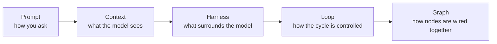
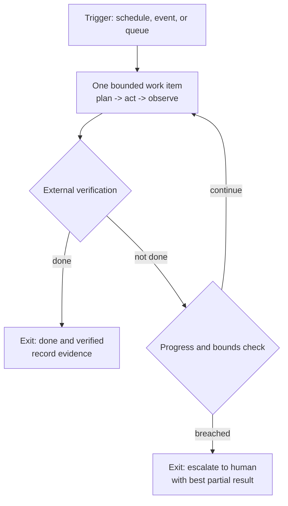

# Modern AI Agents with Hermes: Knowledge Sharing

> **Draft v0.1** for review. This is the master working note: run sheet, speaking script, and the on-screen document all in one. No slides needed.
> **Session:** internal knowledge sharing for developer colleagues (mixed seniority). Delivered in Thai, technical terms kept in English. Target ~45 min, trimmable to 30, stretchable to 60. Section 6 has the trim/stretch guide.
> **Format:** talk + open examples from this note, my vault files, and websites. No slides, no prepared live demo. Every "Show" moment below has the exact path or URL to open.
> **Thesis (one line):** Modern AI agents are not about better prompts. They are about the system around the model: the harness, the loop you design, and the graph above that. Hermes is the living specimen that makes it concrete.

**TL;DR to internalize before walking in:**

1. The model is not the product; the **harness** is. Same model, different harness = different capability.
2. For recurring work, design a **loop**: verified progress + bounds + designed exits. If nothing external verifies "done", it is not a loop, it is a bill.
3. The ladder composes: **prompt -> context -> harness -> loop -> graph**. Diagnose a failure by the layer it lives in before changing anything.

---

## 1. Session brief

| Item | Detail |
|---|---|
| Audience | Developer colleagues, mixed seniority: some AI-curious, some skeptical. Speak to juniors without losing seniors. |
| Language | Thai delivery; English technical terms kept as-is. Appendix A has the glossary + ready-to-say lines. |
| Length | 45 min core + up to 15 min Q&A. |
| Format | Talking + screen sharing. This note is the master doc on screen. |
| Materials | No slides, no live demo. Three "show" moments (SOUL/skills, the cron loop, job-hunting-loop) + websites. |
| Takeaway | Three ideas (above) + a curated link list (Appendix B) that is safe to share internally. |

### Blurb for the announcement (Thai, paste into chat)

> 📣 Knowledge Sharing: Modern AI Agents กับ Hermes
> เอเจนต์ AI ยุคนี้ทำงานจริงได้อย่างไร ตั้งแต่ prompt สู่ context สู่ harness สู่ loop สู่ graph พร้อมตัวอย่างจริงจากระบบที่ผมใช้ทุกวัน และกรณีศึกษา loop หางานแบบโอเพนซอร์ส
> ⏱️ ประมาณ 45 นาที ไม่มีสไลด์ คุยและเปิดตัวอย่างจากของจริง
> 📍 [สถานที่] | 🗓️ [วันเวลา]

---

## 2. Run sheet

| Time | Segment | What happens | Open on screen |
|---|---|---|---|
| 0:00-0:03 | Open + hook | Personal hook, thesis, session roadmap | This note |
| 0:03-0:10 | 1. Model vs harness | The 2023-2026 arc; what an agent actually is; "same model, different harness" | [[03_agentic-ai-frameworks-and-terminology]] (Part 6 + Part 8) |
| 0:10-0:18 | 2. The layer ladder | 5 layers, failure-mode table, the buzzword test | This note (tables below) |
| 0:18-0:30 | 3. Hermes specimen | Profiles/SOUL, skills, memory, and a real cron loop | Registry -> Overview.md -> SKILL.md -> cron list/output |
| 0:30-0:40 | 4. Loop engineering | Convergence trio, checklist highlights, the job-hunting-loop case study | loop-engineering.md (GitHub) -> job-hunting-loop repo |
| 0:40-0:45 | 5. Graph + close | Graph layer teaser, takeaways, call to action | graph-engineering.md (quick scroll) -> Hermes docs |
| 0:45-1:00 | Q&A | Use Section 5 prep | As needed |

Ordering rule for every segment: **point first, jargon second**. Show the thing, name the concept, then land the one-liner. The audience remembers the demo longer than the definition.

---

## 3. Segments (talk track + what to open)

### Segment 0: Open + hook (3 min)

**Goal:** earn attention with a real story, then give the roadmap.

**Say:**
- Most of us have tried using AI for real work: it helps, then hits a wall. It forgets. It cannot act. It needs me to babysit every step.
- The 2026 answer is not a smarter model. It is the system around the model. The wall was never intelligence; it was architecture.
- Credibility, fast: "I run this daily. My notes vault is built by agent pipelines. I have a job running on my machine three times a day that checks my email, calendar, weather, and system health. And I built a public job-hunting loop as a case study of the discipline behind all this."
- Roadmap: today we walk one ladder: prompt -> context -> harness -> loop -> graph. Then I show you my actual system as the specimen. Then we end with what a loop really is, and what comes after.

**Land it:** "By the end you will have a mental model and an honest vocabulary: enough to evaluate tools without the hype, and to build one small loop yourself."

---

### Segment 1: Model vs harness: what actually changed (7 min)

**Goal:** shift the frame from "which model is smartest" to "what surrounds the model".

**Say:**
- The 3-year arc in one breath: 2023 was prompt engineering (how you ask). 2025 was context engineering (what the model sees). 2026 is harness engineering (what surrounds the model: tools, permissions, memory, the loop, the UX).
- Define the term gently: **an agent harness is the scaffolding around a model that makes it an agent.** Claude Code, Cursor, Codex, OpenCode, Hermes: all harnesses. When you "use Claude Code" or "use Hermes", you are not using a model, you are using a harness around a model.
- The 2026 consensus line: **the harness matters more than the model.** Same model, different harness = very different capability. That is why two people with the same model get completely different results.
- What is an agent, explicitly: a system where the model decides what to do next, in a loop, using tools. As opposed to a fixed pipeline where you decide each step. Loop = perceive -> plan -> act -> observe -> repeat.

**Show:** open [[03_agentic-ai-frameworks-and-terminology]], go to **Part 6 (Agent Harnesses)** and the **Part 8 status table**. If the room wants the wider landscape, [[04_ai-tools-landscape-2026]] has the tool map.

**Land it:** "When someone says 'this AI is dumb', the failure is usually not the model. It is the harness."

---

### Segment 2: The layer ladder (8 min)

**Goal:** install the vocabulary as a diagnostic tool, not decoration.

**Say:**
- Five words get thrown around like synonyms. They are not synonyms. They are layers, and each layer answers a different question:
- Walk the table below.
- The point of the layers: **each one fails in a different way.** When something breaks, match the symptom to the layer BEFORE changing anything. Most teams rewrite the prompt when the real failure is context, harness, or loop.
- The buzzword test (skeptic-proofing): these words also sell courses and consulting. The test: can the person explain what FAILS when that layer breaks? If not, it is marketing.

**The ladder in one picture (show this):**

**Layer table (show this):**

| Layer | The question it answers | Primitive | 2026 status |
|---|---|---|---|
| Prompt engineering | How do I phrase the instruction? | instruction text | Established, and the smallest layer |
| Context engineering | What goes inside the model's window, and how is it curated? | retrieval, memory, window budget | Established (the actual daily work) |
| Harness engineering | What scaffolding surrounds the model? | tools, permissions, loop, UX | Emerging, trending hard |
| Loop engineering | How is the agent's cycle designed? | the run: bounds, stops, exits | Emerging, genuinely useful |
| Graph engineering | How are nodes, edges, and state wired together? | nodes, edges, state | Contested / rebrand (state machines) |

**Failure-mode table (the diagnostic that makes the words useful):**

| If this layer is broken | The symptom you see |
|---|---|
| Prompt | Model understood the task but did the wrong thing (wording/format problem) |
| Context | Model never saw the right information |
| Harness | Model is fine, system fails: tools mis-scoped, permissions wrong, no checkpointing |
| Loop | Agent runs forever, gives up early, or burns budget |
| Graph | Multi-agent system deadlocks, loops, or loses state between agents |

**Land it:** "Do not compare tools on 'which AI is smarter'. Compare harnesses on these layers. That is the difference between buying a product and engineering one."

---

### Segment 3: Hermes as the living specimen (12 min)

**Goal:** make all of it concrete with files the room can see. Nothing here is a black box: everything is plain text.

**Say:**
- What Hermes is, in three bullets: an open-source agent framework (by Nous Research); same category as Claude Code, Codex, Cursor; runs in the terminal, a desktop app, and chat platforms like Telegram; provider-agnostic, so the model underneath is swappable (any major provider, plus local models).
- Why I picked it as the specimen: **every part of the system is a readable file.** Profiles, skills, schedules: all text. You can inspect my whole setup.
- Four features, and which ladder layer each one demonstrates:
  - **Profiles + SOUL files (harness layer):** a persona as a markdown file. Identity, methodology, output rules, guardrails. I run a fleet of 16 specialists: engineering roles (product owner, full-stack, devops, QA, security...), plus life roles (educator, career coach, book summarizer...). Each is one file.
  - **Skills (context + procedural memory):** reusable procedures saved as markdown. When a task type comes back, the agent loads the skill instead of me re-explaining. My backup has 113 skills (22 main + 8 shared + 83 profile-specific as of the last backup). Categories: book summarization, vault management, project docs, presentations, homelab, dev workflows.
  - **Memory (context layer):** small persistent notes that survive across sessions: who I am, preferences, environment facts.
  - **Cron (loop layer):** the agent runs on a schedule without me typing anything. I have a "Daily Heartbeat Check" job: 3 times a day, it rotates through checks (email, calendar, weather, homelab alerts), stays silent when nothing is urgent, and sends an alert when something is. It has run 50 recorded times since mid-September, including this morning at 09:04.

**Show (in this order):**

1. **The fleet:** open `F:\obsidian_note\hermes_config_backup\soul-collection\profile-registry.md`. Point at the routing table (16 specialists). Then open `F:\obsidian_note\hermes_config_backup\soul-collection\AI-SDLC\llmops-soul.md` (alt: `...\Life Styles\educator-soul.md`) and read 3-4 lines to show the anatomy: identity, mission, method, output rules. Say: "This is a markdown file. Anyone can write one. That is the whole trick."
2. **The skills:** open `F:\obsidian_note\hermes_config_backup\workflow\Overview.md`: show the count (113) and the categories. Then open one skill end-to-end: `F:\obsidian_note\hermes_config_backup\workflow\hermes-main-profile\project-launch-checklist\SKILL.md`. Point at frontmatter (name, trigger, when to use) + numbered steps. Say: "A skill is a procedure that worked once, written down so it works every time."
3. **The loop:** in a fresh terminal run `hermes cron list` (it shows under your default profile), or open `C:\Users\Admin\AppData\Local\hermes\cron\output\7f9258274435\` and show the 50 run files. Open one output file and show what a run report looks like. Tell the story: set up back in June, runs at 9:00, 14:00, 20:00; silent unless something needs me.
   ⚠️ **Screen hygiene:** skim the output folder before showing it. It can contain personal alerts (hardware issues, calendar details). Pick a boring/generic file or show only the folder listing.

**Facts to cite (verified 2026-10-09):** 16 profiles; 113 skills (as of last backup); heartbeat job created 2026-06-23, schedule 0 9,14,20 * * *, 50 recorded runs from 2026-09-14 onward, latest run 2026-10-09 09:04.

**Land it:** "A harness is config and files: profiles, skills, schedules. This is why I keep saying: the harness matters more than the model."

---

### Segment 4: Loop engineering + the case study (10 min)

**Goal:** define the discipline, then show it instantiated in a real repo.

**Say:**
- Definition: **loop engineering is designing the outer loop around your agent**: the system that finds the work, hands it out, checks the result, records what is done, and decides what happens next. Design once, instead of prompting per turn.
- The inner loop (gather context, act, verify) largely ships with the model and the harness. **The outer loop is yours to build.** It is the difference between an agent that runs for days and one that melts by morning.
- The convergence rule: a loop converges when three things are true together:
  1. **A progress measure that is external and verified** (tests passing, files existing, cards moving): never the model's self-report.
  2. **Bounds:** max iterations per run, token/cost budget, wall-clock timeout.
  3. **Designed exits:** done-and-verified, budget-exhausted, escalated-to-human. Everything else (crashed, wedged) is a bug.
- A loop missing any one of the three is a runaway waiting for a quiet weekend. Say the sharp version: "If nothing external can verify 'done', you do not have a loop. You have a bill."
- From my 12-section checklist, the six that matter most: external verification only; maker/checker separation (never let the implementer grade its own homework); budgets as termination guarantees; a no-progress tripwire; human gates as designed exits, placed before irreversible actions; state kept outside the context window.
- Anti-patterns quickfire (pick 3): unattended loop with no budget; self-certifying loop; retrying deterministic failures; stop condition = "the model stopped talking".

**The convergence picture (show this):**

**Show:**

1. Open `https://github.com/oat431/swe-knowledge/blob/main/checklist/ai-checklist/loop-engineering.md` and scroll the section list (visual proof of the discipline), then jump to section 12, anti-patterns.
2. Open `https://github.com/oat431/job-hunting-loop` and walk the README:
   - What it does: a scheduled loop that searches job boards, screens postings against my positioning document, tailors my resume per posting, and drops application-ready PDFs into a review folder. It never applies, emails, or uploads. Ever.
   - Why it is loop engineering and not just a pipeline: the machinery. Dedup state makes idle runs cost about zero. An independent honesty checker verifies every claim against my fact vault (maker/checker). The profile folder is a frozen anchor the loop may not rewrite. The human gate is permanent, before anything leaves the loop.
   - The honest pitch: the resumes are the proof; the loop machinery is the product. It is a cloneable template: bring your own story, configure, run.

**Land it:** "A loop earns its cost only when the path depends on intermediate results you cannot enumerate. If you already know the steps, write them as code. A loop doing a pipeline's job is 5-10x cost for zero gain."

---

### Segment 5: Graph engineering + close (5 min)

**Goal:** show the layer above loops honestly, then give the three takeaways.

**Say:**
- One loop covers one agent's cycle. When multiple steps and roles branch, retry with different strategies, and must survive across sessions, you are no longer designing a loop; you are designing a **graph**: nodes, edges, and state. The graph decides what happens next; the model only contributes judgment where judgment is needed.
- Not every node is an LLM: deterministic functions, routers, joins, validators, and human checkpoints belong in the topology. "If you already know the business rule, put it in code."
- Honest status: this is an emerging framing (mid-2026), and the label is contested. State machines are decades old; the name is new. Use it as shorthand, be ready to say "it is state-machine design for agent topologies", and do not pay for the rebrand.
- One-breath teaser of the meta-layer: at scale you are designing graphs of loops, and four failures show up: metrics that detach from reality, loops that cannot question their own targets, loops that fight each other, and nobody watching the watcher. Counter-metrics and frozen anchors are the answer. That is a whole other talk; one breath only.
- Close: three takeaways. The model is not the product; the harness is. For recurring work design a loop: verified progress, bounds, exits. And diagnose by layer before changing anything. The ladder composes; you do not skip rungs. Most work needs prompt + context + a bit of harness long before it needs a graph.

**Show:** open `https://github.com/oat431/swe-knowledge/blob/main/checklist/ai-checklist/graph-engineering.md`, scroll the headers for 20 seconds (no deep-dive), then finish on the resources page: `https://hermes-agent.nousresearch.com/docs`.

**Land it:** "Start with the simplest rung that could work. Climb only when the rung below demonstrably fails. That is the whole engineering discipline here."

---

## 4. Q&A prep (short answers, point-able)

| Question | Short answer |
|---|---|
| Which AI coding tool should we use at the office? | They are all harnesses, and the model underneath is increasingly swappable. Compare on: permissions model, context features, extensibility (skills/rules), where it runs, and data policy. Try one real task on 2-3 before deciding. Hermes is the self-hosted, provider-agnostic, fully-file-transparent option. |
| How do I start on Monday? | Install one harness, run one real (not toy) task, then convert one recurring chore into a skill or a loop. Start manual, run it by hand about 3 times, then schedule it. Read the loop checklist before automation grows. |
| Is it safe with company code? | Think in layers: least-privilege tools, sandbox for untrusted work, secrets in environment/vault (never in prompts), human gates before destructive or external actions, guardrails on tool traffic. And treat web pages, docs, and emails as untrusted input: prompt injection is a real attack class. |
| What does it cost to run loops? | Budgets, not vibes: iteration caps, token budget per run, wall-clock timeout. Route cheap models to routing/formatting and strong models to judgment. Dedup first: idle runs should cost about zero model calls. Loops only pay off when verification is automated. |
| Will this replace developers? | It replaces unverified toil, not judgment. The job moves up a layer: designing loops, verification, and reviews. See [[10_should-we-fear-ai-2026]] for my long-form opinion. |
| Loops vs pipelines vs graphs: what do I actually need? | Simplest rung first: single call -> deterministic pipeline -> routed flow -> bounded loop -> graph -> multi-agent org. Climb only when the rung below demonstrably fails. |
| What is MCP? | The standard way agents connect to tools and data (the agent-to-tool layer). It is the part of the stack that won; you will meet it in any framework. My Hermes connects to MCP servers for filesystem, search, GitHub, postgres. |
| Aren't these buzzwords just marketing? | Partly. Apply the test: can the person explain what FAILS when that layer breaks? Context/harness/loop engineering survive the test. "Graph engineering" is the most contested: know it, use it carefully. |
| Can I build the job-hunting loop myself? | Yes: public MIT template. Clone, bring your own story, configure, run. Even if you never run it, read the design; it is the easiest way to see loop engineering in one codebase. |
| Do I need a GPU or expensive setup? | No. Desktop tools + API keys are enough, and local models are optional. Hermes runs on a laptop and providers are swappable. |

---

## 5. Trim & stretch

**30-minute version:** Open (2 min) -> merge Segments 1 and 2 into one 10-minute walk of the ladder -> specimen: skills + cron only (7 min) -> loop engineering + case study (7 min) -> close with the three takeaways (2 min). Drop the graph segment to a 30-second mention, skip Q&A to "find me after".

**45-minute version (default):** the full run sheet above.

**60-minute version:** full run sheet + open discussion. Optional extras, pick one or two:
- Walk one full `SKILL.md` line by line (the "how a procedure becomes reusable" moment).
- Open [[02_ai-buzzword-map-2026]] as a live "truth-checking the vocabulary" segment.
- Ask the room for their most repetitive task and sketch its loop on a whiteboard: trigger, one bounded item, verification, bounds, exit.
- Open [[04_ai-tools-landscape-2026]] and discuss which harness fits our team.

**If questions run long:** the two cuttable items are the graph deep-dive and the skills walkthrough; both are fully documented in the links.

---

## 6. Pre-flight checklist (day of)

**Tabs and windows to pre-open (in this order):**

1. This note (Obsidian, on screen).
2. `F:\obsidian_note\hermes_config_backup\soul-collection\profile-registry.md`
3. `F:\obsidian_note\hermes_config_backup\workflow\Overview.md` + `...\hermes-main-profile\project-launch-checklist\SKILL.md`
4. A terminal ready for `hermes cron list` (run it once beforehand to warm it up), or the cron output folder `C:\Users\Admin\AppData\Local\hermes\cron\output\7f9258274435\`
5. GitHub: job-hunting-loop README
6. GitHub: loop-engineering checklist
7. GitHub: graph-engineering checklist
8. Hermes docs + the Anthropic post (optional)

**Screen hygiene:**
- Notifications off; close private windows and chats.
- Skim the cron output folder before showing it; the heartbeat logs real alerts. Pick a generic file or show only the folder listing.
- Zoom to ~125% so the room can read the tables.

**Fallbacks:**
- No internet: everything except the two GitHub walkthroughs is local. For the case study, open [[07_job-hunting-as-loop-engineering]] (same machinery and diagram, local copy). For the checklists, open the local copies in `F:\obsidian_note\swe-knowledge\checklist\ai-checklist\`.
- Terminal misbehaving: show the cron output folder instead; same story.
- Running long: cut the graph segment first, keep the loop case study.

---

## 7. Appendix A: Thai glossary + ready-to-say lines

### Terms (say it this way in Thai)

| English term | พูดว่า | ความหมายสั้น ๆ |
|---|---|---|
| prompt | พรอมต์ | คำสั่งหรือข้อความที่ส่งให้โมเดล |
| context window | หน้าต่างบริบท | พื้นที่ความจำที่โมเดลมองเห็นในแต่ละรอบ |
| context engineering | วิศวกรรมบริบท | คัดเลือกว่าอะไรควรอยู่ในสายตาโมเดล |
| harness | โครงห่อโมเดล | โครงรอบโมเดล: เครื่องมือ สิทธิ์ หน่วยความจำ ลูป และ UX |
| agent | เอเจนต์ | AI ที่เลือกเองได้ว่าขั้นต่อไปจะทำอะไร วนเป็นลูป และใช้เครื่องมือได้ |
| agent loop | ลูปของเอเจนต์ | รับรู้ -> วางแผน -> ลงมือ -> สังเกต แล้ววนซ้ำ |
| tool use / function calling | การเรียกใช้เครื่องมือ | ให้โมเดลสั่งเรียกฟังก์ชันหรือ API ได้เอง |
| MCP | MCP (ทับศัพท์) | มาตรฐานกลางเชื่อมเอเจนต์เข้ากับเครื่องมือและข้อมูล |
| skill | สกิล | คู่มือทำงานที่บันทึกไว้ ให้หยิบใช้ซ้ำได้ |
| SOUL / profile | ไฟล์ตัวตน / โปรไฟล์ | นิยามบุคลิก วิธีทำงาน และข้อห้ามของเอเจนต์แต่ละตัว |
| memory | หน่วยความจำ | ข้อมูลที่จำข้ามเซสชัน |
| loop engineering | วิศวกรรมลูป | ออกแบบวงจรงานให้ลู่เข้า: วัดผลได้ มีเพดาน มีทางออก |
| graph engineering | วิศวกรรมกราฟ | ออกแบบโครงสร้างหลายโหนด: โหนด เส้นเชื่อม สถานะ |
| checkpoint | เช็คพอยต์ | จุดเซฟสถานะ ให้หยุดแล้วกลับมาทำต่อได้ |
| human-in-the-loop | คนอยู่ในลูป | ด่านให้คนอนุมัติก่อนงานที่ผลเสียหายแรง |
| bounds / budget | เพดาน / งบ | จำกัดจำนวนรอบ เวลา และโทเคน กันลูปวิ่งไม่หยุด |
| maker / checker | คนทำ / คนตรวจ | แยกคนทำกับคนตรวจ เอเจนต์ห้ามตรวจงานตัวเอง |
| guardrails | ราวกันตก | กฎตรวจอินพุต เอาต์พุต และก่อน/หลังเรียกเครื่องมือ |
| trajectory | เส้นทางการรัน | บันทึกทุกสเต็ปของเอเจนต์ ใช้ตรวจและดีบัก |
| idempotent | ทำซ้ำได้อย่างปลอดภัย | เรียกซ้ำแล้วผลข้างเคียงไม่ซ้ำ เช่น ไม่ส่งอีเมลซ้ำ |

### Ready-to-say lines (ใช้พูดได้เลย)

- "โมเดลเดียวกัน แต่เปลี่ยน harness ความสามารถคนละเรื่องเลย"
- "สิ่งที่สำคัญกว่าโมเดล คือโครงที่ห่อมันไว้"
- "เอเจนต์ คือ AI ที่ตัดสินใจเองได้ว่าขั้นต่อไปจะทำอะไร วนเป็นลูป และใช้เครื่องมือได้"
- "เวลาเจอปัญหา ให้ถามก่อนว่าพังที่เลเยอร์ไหน อย่าเพิ่งรีบไปแก้พรอมต์"
- "ลูปที่ดีต้องมีสามอย่าง: ตัววัดความคืบหน้าที่ตรวจสอบได้จริง เพดานการทำงาน และทางออกที่ออกแบบไว้"
- "ให้เอเจนต์ตรวจการบ้านตัวเองไม่ได้ ต้องมีคนทำกับคนตรวจแยกกัน"
- "งานที่ทำซ้ำ ๆ ให้ออกแบบลูป ไม่ใช่พิมพ์พรอมต์ใหม่ทุกครั้ง"
- "งานไหนพังแล้วเจ็บ ให้มีด่านคนอนุมัติก่อนเสมอ"
- "กราฟเป็นเลเยอร์บนสุด ยังใหม่และยังเถียงกันอยู่ ใช้เมื่อลูปธรรมดาไม่พอจริง ๆ"

---

## 8. Appendix B: links to share after the session

**My artifacts (public GitHub):**

- Job-hunting loop (the case study): https://github.com/oat431/job-hunting-loop
- Loop engineering checklist: https://github.com/oat431/swe-knowledge/blob/main/checklist/ai-checklist/loop-engineering.md
- Graph engineering checklist: https://github.com/oat431/swe-knowledge/blob/main/checklist/ai-checklist/graph-engineering.md
- AI knowledge vault, applied pillar: https://github.com/oat431/ai-knowledge/tree/main/04_Applied_AI_Engineering
- Hermes config backup (souls + skills): https://github.com/oat431/hermes_config_backup
- Agentic AI terminology note: https://github.com/oat431/oralita_md/blob/main/personal/ai/03_agentic-ai-frameworks-and-terminology.md

**External:**

- Hermes docs: https://hermes-agent.nousresearch.com/docs (machine index for agents: https://hermes-agent.nousresearch.com/docs/llms.txt)
- Hermes repo: https://github.com/NousResearch/hermes-agent
- Anthropic, "Building effective agents": https://www.anthropic.com/engineering/building-effective-agents
- Anthropic, "Effective harnesses for long-running agents": https://www.anthropic.com/engineering/effective-harnesses-for-long-running-agents
- Model Context Protocol: https://modelcontextprotocol.io

---

## 9. Notes for v0.2 (open for review)

- [ ] Lock the timeslot and final length (30 / 45 / 60) and trim the run sheet accordingly.
- [ ] Confirm room AV: screen share works, font size readable, terminal available for `hermes cron list`.
- [ ] Decide what the cron segment shows: live command vs output folder vs both. Check the chosen output file for private content.
- [ ] Optional: add a 3-line "why Hermes specifically" honesty note if the room reads it as a product pitch.
- [ ] After delivery: capture the questions asked, add them to Section 4, and decide whether to turn this into a vault note series (per [[03_knowledge-communication]]).

---

*Drafted by Edu (📚), 2026-10-09, v0.1. Sources: [[03_agentic-ai-frameworks-and-terminology]], [[07_job-hunting-as-loop-engineering]], [[02_ai-buzzword-map-2026]], [[04_ai-tools-landscape-2026]], and the loop-engineering / graph-engineering checklists in swe-knowledge. All facts verified against the live machine and public repos on 2026-10-09.*
